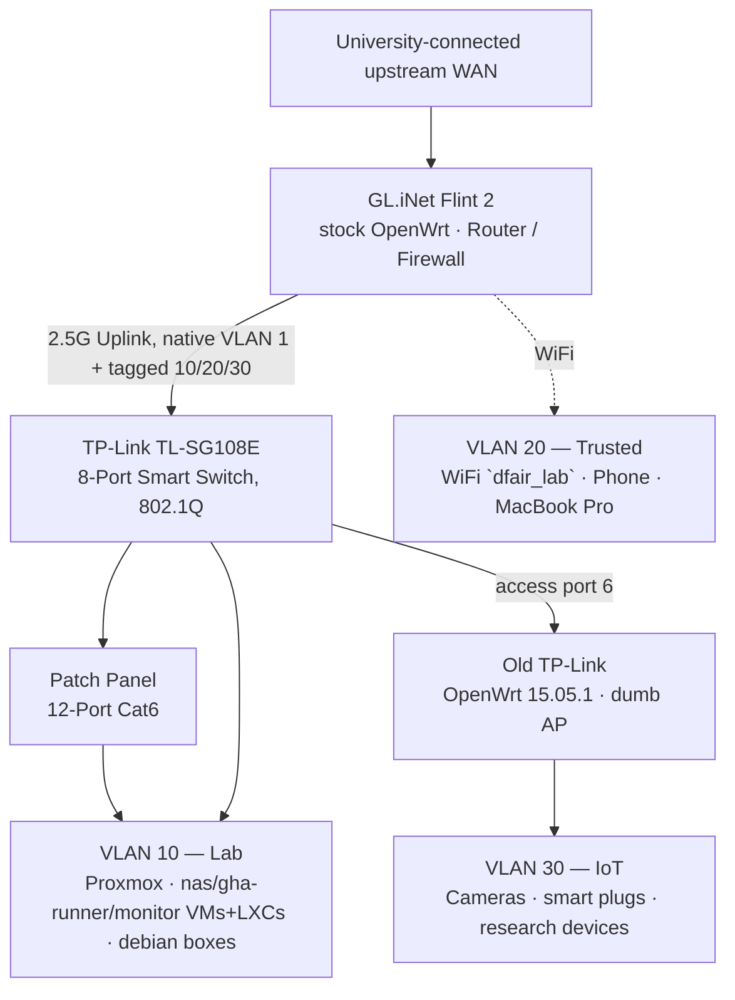

# 🏠 Homelab Documentation

> Personal homelab documentation — migrated from the PhD lab environment to home. GL.iNet Flint 2 + TL-SG108E + VLAN segmentation now live.

## Quick Links

| Section | Description |
|---|---|
| [Physical Infrastructure](docs/physical/README.md) | Rack layout, hardware inventory, power |
| [Networking](docs/networking/README.md) | Topology, VLANs, firewall, VPN |
| [Services](docs/services/README.md) | Proxmox VMs, NAS, monitoring, self-hosted apps |
| [Devices](docs/devices/README.md) | All connected endpoints |

## High-Level Overview



## Status

| Item | Status |
|---|---|
| Physical rack build | ✅ Done |
| GL.iNet Flint 2 as main router | ✅ Running |
| VLAN configuration (10 Lab / 20 Trusted / 30 IoT) | ✅ Done — all 3 VLANs live, devices migrated, static reservations set |
| Proxmox setup | ✅ Running |
| NAS / storage | ✅ Done |
| VPN (inbound) | ✅ VPS-relayed WireGuard live 2026-10-25; XPS off-network access validated, reboot/isolation checks pending |
| Mullvad selective egress | ✅ NAS + Telegram proxy Mullvad egress and switchable VLAN 20 VPN/WAN mode verified 2026-10-25; reboot/boot-order audit pending |
| GitHub Actions runners | ✅ KC + DFAIR + KC-Timing; Timing deployed 2026-10-27; [nightly source update checks](docs/services/github-actions-runners.md) (check-only) |
| Monitoring stack | ✅ Kuma 2.5.7 with tested Telegram alerts; Prometheus/Grafana metrics running; runner job-active test pending |
| VLAN 30 Internet egress | 🔒 IoT → WAN forwarding removed 2026-10-22; client validation pending |

## Repo Structure

```text
homelab-docs/
├── README.md                   ← You are here
├── docs/
│   ├── physical/
│   │   ├── README.md           ← Rack layout & hardware inventory
│   │   ├── power.md            ← UPS, PDU, power planning
│   │   └── rack-layout.md      ← Visual rack diagram & placement
│   ├── networking/
│   │   ├── README.md           ← Network overview & topology
│   │   ├── vlans.md            ← VLAN design & policy
│   │   ├── firewall.md         ← Firewall rules & design
│   │   └── vpn.md              ← Inbound VPN & Mullvad config
│   ├── services/
│   │   ├── README.md           ← Services overview
│   │   ├── proxmox.md          ← Proxmox setup & VMs
│   │   ├── nas.md              ← NAS / storage / qBittorrent
│   │   └── monitoring.md       ← Monitoring stack
│   └── devices/
│       └── README.md           ← Device inventory & notes
└── assets/                     ← Diagrams, screenshots
```
