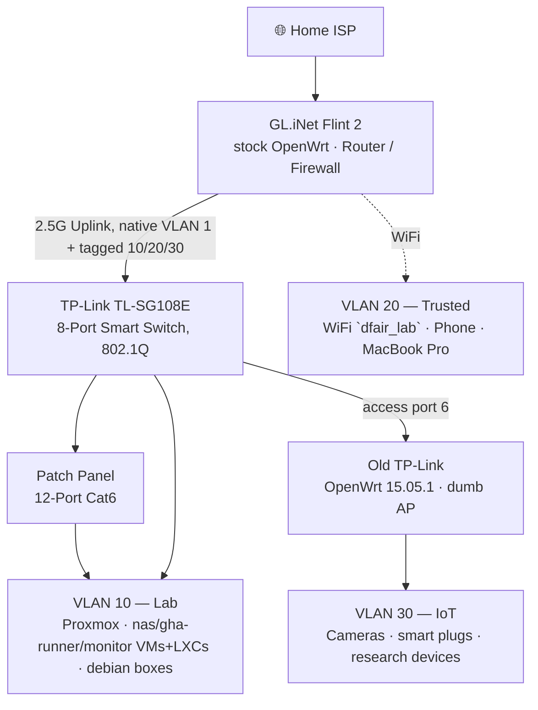

# 🏠 Homelab Documentation

> Personal homelab documentation — migrated from the PhD lab environment to home. GL.iNet Flint 2 + TL-SG108E + VLAN segmentation now live. Public for research reproducibility.

## Quick Links

| Section | Description |
|---|---|
| [Physical Infrastructure](physical/README.md) | Rack layout, hardware inventory, power |
| [Networking](networking/README.md) | Topology, VLANs, firewall, VPN |
| [Services](services/README.md) | Proxmox VMs, NAS, monitoring, self-hosted apps |
| [Devices](devices/README.md) | All connected endpoints |

## High-Level Overview

## Status

| Item | Status |
|---|---|
| Physical rack build | ✅ Done |
| GL.iNet Flint 2 as main router | ✅ Running |
| VLAN configuration (10 Lab / 20 Trusted / 30 IoT) | ✅ Done — all 3 VLANs live, devices migrated, static reservations set |
| Proxmox setup | ✅ Running |
| Hermes HP gateway | Retired; HP repurposed for RG3 passive capture |
| Local GPU LLM (Phase 4) | VM108 powered off; configuration retained — [runbook](services/local-llm.md) |
| NAS / storage | ✅ Done |
| VPN (inbound) | ✅ VPS-relayed WireGuard live 2026-10-25; XPS off-network access validated, reboot/isolation checks pending |
| Mullvad selective egress | NAS and Telegram proxy egress and VLAN 20 VPN/WAN toggle deployed; reboot audit pending |
| GitHub Actions runners | DFAIR ARC on VM101; Kart-Chaser ARC on Lenovo (VLAN 10); KC-Timing retained — [runbook](services/github-actions-runners.md) |
| Monitoring stack | 🔧 Running; runner job-exporter added 2026-10-22, job-active test pending |
| RG3 IDS passive capture | Software accepted; hardware pending — [runbook](networking/rg3-capture.md) |
| VLAN 30 Internet egress | October baseline; current research policy requires reconciliation |

!!! note
    This page mirrors the repo's root `README.md` (GitHub's landing page) for
    the built site's homepage. Keep both in sync when either changes.

## Mullvad egress and Telegram notifications (2026-10-25)

Selective Mullvad egress is deployed for [NAS/qBittorrent](services/nas.md), [Telegram proxy CT 107](services/telegram-proxy.md), and switchable Trusted VLAN 20 using Flint 2 `trusted-vpn on|off|status`. [Uptime Kuma 2.5.7](services/monitoring.md) sends tested Telegram alerts via the proxy. See the [Mullvad runbook](networking/mullvad.md) for validation, safe rollback, and reboot/boot-order follow-ups.
