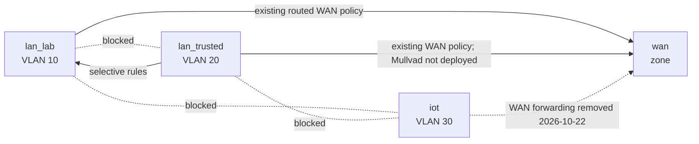

# Firewall

The GL.iNet Flint 2 runs OpenWrt, giving full nftables/iptables access alongside the LuCI GUI. Firewall rules are applied at the router level between VLAN interfaces.

## Zone Model



## Default Zone Policies

| Zone | INPUT | OUTPUT | FORWARD |
|---|---|---|---|
| wan | DROP | ACCEPT | DROP |
| lan_lab | ACCEPT | ACCEPT | ACCEPT |
| lan_trusted | ACCEPT | ACCEPT | ACCEPT |
| iot (VLAN 30) | DROP | ACCEPT | DROP |

## Deployed WireGuard relay allowlist (2026-10-25)

The remote tunnel terminates at a public VPS, **not** the Flint 2 WAN. On the VPS, UFW defaults to `deny (routed)` and permits XPS peer `10.100.0.10` through interface `wg-homelab` only to: router WG peer `10.100.0.2` (routed), Proxmox `192.168.10.10` TCP 22/8006, Caddy `192.168.10.50` TCP 443, and router DNS `192.168.10.1` TCP/UDP 53. On Flint 2, firewall zone `wg_homelab` has REJECT input, ACCEPT output and REJECT forward with corresponding targeted rules. Router UCI rules include `allow_vps_wg_ping`, `allow_xps_wg_ping`, `wg_xps_proxmox`, `wg_xps_caddy`, `wg_xps_dns`. The router has no required inbound UDP port forward. These are the **verified rule definitions**, not proof of negative isolation tests. See [VPN](vpn.md) for routing, public peer keys and security follow-ups.

## Planned Firewall Rules

### WAN → Router (INPUT) — historical planning sketch
| # | Protocol | Port | Action | Notes |
|---|---|---|---|---|
| 1 | UDP | 51820 | N/A on Flint 2 | WireGuard inbound is terminated on public VPS, **not** forwarded to router WAN |
| 2 | TCP | 22 | DROP | No SSH from WAN — use VPN |
| — | * | * | DROP | Default deny |

### Trusted VLAN → Internet
This is a **planned concept**, not deployed. Selective Mullvad egress for NAS and Kuma Telegram is proposed; blanket VLAN 20 tunneling and a kill switch have not been implemented:

```text
# Conceptual nftables kill switch
chain forward {
    iifname "br-trusted" oifname != "mullvad0" drop
}
```

### IoT VLAN — Planned exception policy (not deployed)
Historic design only; **VLAN 30 WAN forwarding was removed on 2026-10-22**, and the table below is *not* a list of deployed rules. An existing DHCP/DNS exception remains and must be reviewed separately.

| Protocol | Destination | Action | Notes |
|---|---|---|---|
| UDP/TCP | 53 | ACCEPT | DNS (router only) |
| TCP | 80, 443 | ACCEPT | HTTP/HTTPS if needed |
| * | RFC1918 | DROP | No lateral movement |
| * | * | DROP | Default deny |

### Selective Trusted → Lab Access
Add rules as needed. Starting point — only Proxmox UI:

| Protocol | Destination | Port | Action |
|---|---|---|---|
| TCP | 192.168.10.10 | 8006 | ACCEPT (Proxmox web UI) |
| TCP | 192.168.10.10 | 22 | ACCEPT (SSH to Proxmox) |
| * | 192.168.10.0/24 | * | DROP |

## VLAN 30 outbound isolation — applied 2026-10-22

On the Flint 2 (OpenWrt 23.05.5), VLAN 30 is named **`iot`**, not `edge`:
`network.iot.device=br-lan.30`, gateway `192.168.30.1/24`, firewall
zone `firewall.iot` with `input=DROP`, `output=ACCEPT`, `forward=DROP`.
Removed the `iot` → `wan` **zone forwarding** while retaining `lan`, `lab`,
and `trusted` → `wan`. The attempted `edge` source rule was invalid and
was deleted. Backed up `/etc/config/firewall` to
`/root/firewall-before-vlan30-block.bak`; `fw4 check` reported
`Ruleset passes nftables check` and firewall reload succeeded.

This is **router-side configuration verification**, not a completed
end-to-end test. Verify on a VLAN 30 client that IPv4 HTTPS, ping and IPv6
Internet connectivity are blocked; verify intended DHCP/DNS still works.
`Allow-IoT-DHCP-DNS` is still configured but its exact rule contents were
not examined in the captured output. Router-resolved DNS may still forward
queries externally. Inspect policy routing, VPNs, redirects and IPv6 before
claiming airtight isolation; layer-2 peers on the same VLAN are not separated
by OpenWrt's inter-zone firewall.

```bash
uci show network.iot
uci show firewall.iot
uci show firewall.@rule[9]  # verify actual DHCP/DNS allowances
fw4 check
uci show firewall | grep -E '=forwarding|\.src=|\.dest='
```

## Internal HTTPS access (deployed 2026-10-20)

The existing broad section above documents the planned baseline, **not a fully audited live firewall ruleset**. During the internal HTTPS deployment, selective Trusted (VLAN 20) → `certs-01` (`192.168.10.50`) TCP access was configured for SSH **22** and web **80/443**. Grafana and Uptime Kuma are reached through Caddy on port 443. Proxmox's CA-signed UI still uses direct `192.168.10.10:8006` access. On 2026-10-21 a Trusted VLAN client (`192.168.20.173`) successfully reached `https://cs-leaderboard.home.arpa` via `certs-01:443`, confirming effective connectivity for that path (not the exact active UCI rule definitions). Caddy forwarded to nginx on `dell-mini` (`192.168.10.117:80`) on VLAN 10. Existing direct `lan`/`trusted` → `dell-mini:80` rules remain documented; these were not removed. Restricting direct HTTP access to Caddy is a future hardening option because directly supplied `X-Real-IP` may influence FastAPI rate limiting.

The Caddy metrics endpoint `192.168.10.50:9180` is for `monitor-01` (`192.168.10.158`) within VLAN 10. Caddy currently uses a source-IP matcher to reject other clients, but a cross-client test and additional Proxmox/LXC firewall restriction remain outstanding. The admin endpoint `127.0.0.1:2019` **must never be exposed on the network**. Same-VLAN traffic is not secured by OpenWrt's inter-VLAN rules alone.

## TODO

- [ ] Negative tests from remote XPS to VLAN 20, VLAN 30, unapproved Lab services, and IPv6 paths
- [ ] Verify dnsmasq UDP/TCP 53 not reachable from WAN after `localservice=0`

- [x] VLAN 30 `iot` zone configured and IoT → WAN forwarding removed (2026-10-22); client testing pending
- [ ] Configure Mullvad WireGuard interface + kill switch
- [ ] Test VLAN isolation with `nmap` cross-VLAN scans
- [ ] Set up firewall logging for dropped packets (helps with debugging IoT devices)
- [ ] Consider running a dedicated firewall VM on Proxmox (e.g. pfSense/OPNsense) in the future for more granular control
