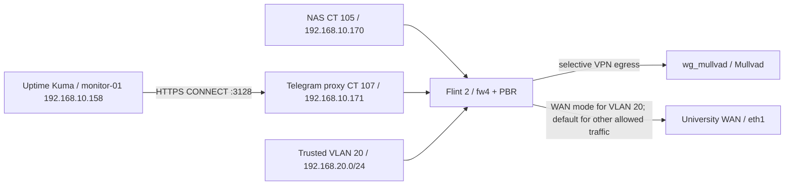

# Outbound Mullvad — deployment and operations

**Deployed 2026-10-25; router:** `flint2` (OpenWrt 23.05.5); **tunnel:** `wg_mullvad`; **WAN:** `eth1`. This is separate from the VPS-relayed inbound `wg_homelab` tunnel. No secret WireGuard key, bot token, or private configuration backup belongs in this repository.

## Scope and topology



| Source | VPN policy | Local exceptions / notes |
|---|---|---|
| NAS `192.168.10.170` | Always Mullvad | `pbr.nas_local` then `pbr.nas_mullvad`; eth1 guard |
| Telegram proxy `192.168.10.171` | Always Mullvad | `pbr.telegram_local` then `pbr.telegram_mullvad`; eth1 guard |
| Trusted `192.168.20.0/24` | Operator selectable | `pbr.trusted_local` then `pbr.trusted_mullvad`; VPN-mode eth1 guard and DNS DNAT |
| Other devices / router-generated traffic | Unchanged | WAN remains router's default; inbound `wg_homelab` independent |

`pbr` 1.1.6-22 uses fw4 nft-file mode and `resolver_set=none`, IPv6 PBR is disabled. Source-specific `ignore` exceptions cover `192.168.1.0/24`, `192.168.10.0/24`, `192.168.20.0/24`, `192.168.30.0/24`, `10.100.0.0/24` before the source-wide Mullvad route. The WireGuard public endpoint observed was `45.134.140.130:51820` and the verified Mullvad exit IPv4 was `45.134.140.138`; addresses can change. Router university WAN address was `10.19.13.231` with public exit `158.93.6.19`.

## Trusted VLAN toggle

`/usr/bin/trusted-vpn` on **Flint 2** operates only on Trusted VLAN 20:

```sh
trusted-vpn status
trusted-vpn on    # requires Mullvad interface UP
trusted-vpn off   # restore normal WAN routing and DNS
```

**VPN mode**: install `/etc/nftables.d/40-trusted-mullvad-guard.nft` from `/root/trusted-mullvad-guard.template`, validate/reload fw4, enable `firewall.trusted_vpn_dns` (DNAT TCP/UDP 53 to `192.168.10.171`), then enable `pbr.trusted_local` and `pbr.trusted_mullvad` and restart PBR. Verify the effective guard exists before enabling PBR.

**WAN mode**: disable only the two Trusted PBR entries and restart PBR; disable Trusted DNS DNAT, reload fw4; remove the Trusted guard file and reload fw4; **flush and delete any leftover `inet fw4 trusted_mullvad_guard` chain**. The last cleanup is required in this deployment: removing an include file/reloading fw4 left a stale independently hooked chain. `trusted-vpn status` checks UCI and the live chain and reports `INCONSISTENT` when they disagree. If a transition fails, inspect/repair it before re-running; script has no atomic transaction/automatic rollback. Do not use a blanket `nft flush ruleset` or delete the entire `inet fw4` table.

The guard currently blocks IPv4 from `br-lan.20` / `192.168.20.0/24` out `eth1`, and IPv6 from `br-lan.20` out `eth1`. This is **not a general-purpose all-interface leak-proof policy**: audit additional WAN interfaces, flow offloading, direct encrypted DNS, and startup ordering before claiming that. Router locally originated traffic is not protected by this forwarded-traffic guard.

```sh
# On Flint 2 — read-only state checks
trusted-vpn status
uci get pbr.trusted_mullvad.enabled
uci get firewall.trusted_vpn_dns.enabled
nft list chain inet fw4 trusted_mullvad_guard  # expected only in VPN mode
nft list chain inet fw4 nas_mullvad_guard
nft list chain inet fw4 telegram_mullvad_guard
/etc/init.d/pbr status | grep -E 'Trusted VLAN|NAS Internet|Telegram Proxy Internet'
fw4 check
```

### Trusted DNS path

The Trusted clients continue using router DHCP-advertised DNS `192.168.20.1`; in VPN mode `firewall.trusted_vpn_dns` intercepts **IPv4 TCP and UDP port 53** to DNS server `192.168.10.171`, hosted in CT 107. The resolver forwards public DNS to Mullvad `10.64.0.1` and sends `home.arpa` to `192.168.10.1`; local service names continue working. In WAN mode that DNAT is disabled and router dnsmasq uses university upstreams (`10.127.10.25`, `10.127.10.26` observed). See [Telegram proxy](../services/telegram-proxy.md) and [DNS](dns.md). **DoH/DoT, client DNS caches, and applications using proprietary DNS aren't comprehensively controlled by this port-53 redirect.**

## Deployment evidence and operational tests (2026-10-25)

| Test from Trusted VLAN XPS | Observed |
|---|---|
| `trusted-vpn on` → public IPv4 | `45.134.140.138` (Mullvad) |
| VPN-mode `dig api.telegram.org`, `dig @192.168.20.1`, `dig @1.1.1.1` | `149.154.166.110` (correct Telegram IP, conventional DNS interception verified) |
| `getent ahostsv4 pve.home.arpa` | `192.168.10.10` |
| Proxmox HTTPS | HTTP 200 |
| IPv6 Internet via `curl -6` | Connection failed; **not** exhaustive IPv6 validation |
| With `ifdown wg_mullvad` | External HTTPS timed out; internal DNS and Proxmox HTTP 200 remained working |
| After `ifup wg_mullvad` | Mullvad exit `45.134.140.138` restored; immediate `wg show` may precede asynchronous device creation |
| `trusted-vpn off` → public IPv4 | `158.93.6.19` (university WAN); router DNS again returned Umbrella sinkhole for Telegram |
| `trusted-vpn on` then `off` after stale-chain fix | Both routes verified, `status` in WAN mode showed guard INACTIVE, PBR=0, DNS DNAT=0 |

The manual outage test passed for the observed paths, but router cold-boot ordering and a complete WAN-path/flow-offload audit **remain open**. Leave those as outstanding work; no router reboot test was supplied.

## Recovery and safeguards

- Preserve physical/local router access before modifying firewall, PBR or routing. Config backups from 2026-10-25 include `/root/vlan20-pre-mullvad-20261025-180009/` and later firewall/PBR snapshots; these are **router-local**, not committed, and may contain sensitive material.
- In VPN mode, if external DNS fails, test `dig @192.168.10.171 example.com` from a Trusted client. Confirm CT 107 `dnsmasq`, its DNS guard, and router `firewall.trusted_telegram_dns` (`trusted` → `lab`, TCP/UDP 53).
- If public IP does not switch, inspect both Trusted policies (`enabled=1`), PBR status and `ip -4 route show table pbr_wg_mullvad`; never remove the kill switch to make a broken VPN appear to work.
- If `trusted-vpn off` says `INCONSISTENT`, check for the stale `inet fw4 trusted_mullvad_guard` chain. Only when WAN mode and guard-file removal are confirmed, selectively `nft flush chain inet fw4 trusted_mullvad_guard` followed by `nft delete chain inet fw4 trusted_mullvad_guard`.
- Never delete NAS/Telegram guards or disable `pbr.nas_mullvad` / `pbr.telegram_mullvad` while operating the Trusted toggle.

## Follow-ups

- [ ] Test router reboot in both modes, including transient WAN exposure during boot, startup ordering and PBR/firewall restoration.
- [ ] Audit firewall flow offloading and **all** possible WAN interfaces, rather than only `eth1`.
- [ ] Verify DNS privacy beyond classic UDP/TCP 53, and assess DoH/DoT bypass and IPv6 if upstream connectivity changes.
- [ ] Validate NAS and Telegram services again after a router reboot.
