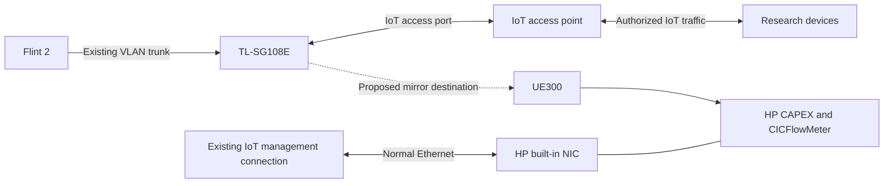

# RG3 IDS research — passive capture network

**Status (2026-11-28):** HP software preparation accepted; UE300 installation,
switch mirroring and live capture acceptance pending. This is a deployment
runbook, not an as-built mirror configuration.

## Design

The Debian HP laptop uses its built-in Ethernet interface for management and
a dedicated TP-Link UE300 USB Ethernet adapter for passive collection. The
monitor interface is not a routed endpoint. Keep the existing VLAN 30
segmentation and management path intact.



The management connection is logical in this diagram: its actual physical
attachment must be confirmed. The old switch inventory is not a current cable
map. Traffic switched entirely inside an AP or router may never reach the
external mirror; the mirror does not guarantee whole-VLAN coverage.

## Verified software and host baseline

- HP runs Debian 13 with systemd-networkd. The built-in NIC is `enp0s25`;
  its current management lease is on VLAN 30, not the older VLAN 10 assignment.
- Existing `10-wired.network` matches the built-in NIC by MAC; its
  `30-capex.conf` drop-in enables IPv4 DHCP and disables IPv6 RA and
  link-local addressing. Preserve these files.
- A USB 3 controller is available. UE300 chipset, driver, MAC, interface
  name and negotiated speeds are not yet verified.
- tcpdump link-type enumeration works with sudo and fails unprivileged;
  no tcpdump file capabilities were reported.
- Clock synchronized, 128 GiB available on the research filesystem.
- CAPEX 1.0.9 production promotion and branch synchronization completed.
  HP passed 148 tests, all five profile dry-runs and historical extraction
  with exact independent TCP/UDP packet conservation and unchanged CSV hash.
  Historical fixture statistics are synthetic, not measured capture loss.

See the CAPEX deployment guide (`DFAIR-LAB-Augusta/CAPEX`, `docs/RG3_CAPTURE.md`)
for software operations.

## Physical switch plan

The earlier [network inventory](README.md#switch-port-assignment) identifies
port 1 as the shared VLAN trunk, port 6 as the IoT AP access port, port 5 as
the former HP Lab connection and port 8 as reserved/maintenance. These are
historical assignments, not authorization to repurpose a port.

1. Record hardware revision, firmware, current cables, VLAN memberships,
   PVIDs and switch management access; save the existing configuration.
2. Confirm the HP's current physical management connection and establish a
   working remote SSH path through the existing management infrastructure.
3. Select an actually free mirror destination (port 8 is only a candidate).
4. Prefer the verified IoT AP access port as a mirror source for ingress and
   egress when it covers the target research traffic. Avoid mirroring the
   shared trunk without a documented need and scope review: it can expose
   unrelated VLANs. Avoid overlapping sources that duplicate frames.
5. Apply revision-specific port mirroring settings, preserving normal VLAN
   memberships and PVIDs unless a separately approved change is needed.
6. Connect the UE300 Ethernet cable only after its addressless configuration
   is ready and the monitor destination is identified.

Record actual source/destination ports, directions, VLAN behavior and observed
coverage after testing. No final mirror port assignment is asserted here.

## Dedicated capture interface

Connect USB first, leaving Ethernet unplugged. Compare `ip -br link`,
`lsusb -t`, kernel logs and `ethtool -i INTERFACE`. Verify the actual MAC,
driver and USB link speed. An empty unprivileged modinfo result with stderr
suppressed is not proof of missing drivers; use the full modinfo path.

Inspect existing networkd rules. Create a separate early-matching
`/etc/systemd/network/05-rg3-capture.network` only after substituting the
verified UE300 MAC:

```ini
[Match]
MACAddress=REPLACE_WITH_VERIFIED_UE300_MAC

[Link]
RequiredForOnline=no

[Network]
DHCP=no
IPv6AcceptRA=no
LinkLocalAddressing=no
```

Do not copy the placeholder literally. Do not bridge or route through the
capture NIC. Reload networkd and reconfigure only the verified USB interface;
do not restart the entire networking stack remotely. Check both IPv4 and
IPv6 addresses/routes, management SSH and absence of unintended capture-NIC
transmissions. Retain the original configuration for rollback.

## Capture permissions and operations

Do not run CAPEX, uv or Python as root or grant them broad capabilities.
Choose a restricted tcpdump privilege arrangement after inspecting its
execution behavior. If executable capabilities are used, restrict access to
authorized operators and document removal and package-update behavior.
Verify actual PCAP write access in the private session directory.

The installed local launcher is `~/.local/bin/rg3-capture`. Its configuration
is `~/.config/rg3/capture.env`; set the verified dedicated interface only.
Research data remains outside Git under `~/research/RG3`.

```bash
rg3-capture status
rg3-capture preflight
rg3-capture smoke
# Set SESSION_DIR to the printed session directory.
rg3-capture verify "$SESSION_DIR"
rg3-capture extract "$SESSION_DIR"
rg3-capture verify "$SESSION_DIR"
rg3-capture account "$SESSION_DIR"
```

Repeat for the 15-minute pilot only after the smoke passes. Longer profiles
require measured storage headroom and explicit acceptance.

## Acceptance and rollback

- [x] HP software and historical extraction regression.
- [ ] UE300 identity, driver, USB and Ethernet link speeds.
- [ ] Existing SSH path and addressless capture interface.
- [ ] Recorded switch configuration and verified mirror coverage.
- [ ] Restricted capture permissions and preflight.
- [ ] 60-second smoke and 15-minute pilot, nonempty PCAPs.
- [ ] Actual zero kernel drops, interface error/drop deltas, valid checksums,
      successful extraction and independent IPv4 TCP/UDP accounting.
- [ ] Traffic coverage, duplicate/encapsulation checks, clock and measured
      storage requirements documented privately.

Zero kernel drops do not establish switch mirror completeness. Investigate
packet mismatches rather than altering accounting values. Keep private PCAPs,
flow data, device identities and detailed diagnostics out of the public repo.

Rollback: stop capture, disconnect the mirror cable, disable the new mirroring
configuration or restore its saved settings, remove only the new adapter
network configuration, undo the chosen capture privilege change and unset
the launcher capture interface. Verify the existing management connection.
No active attack experiments or router firewall changes are part of this plan.
