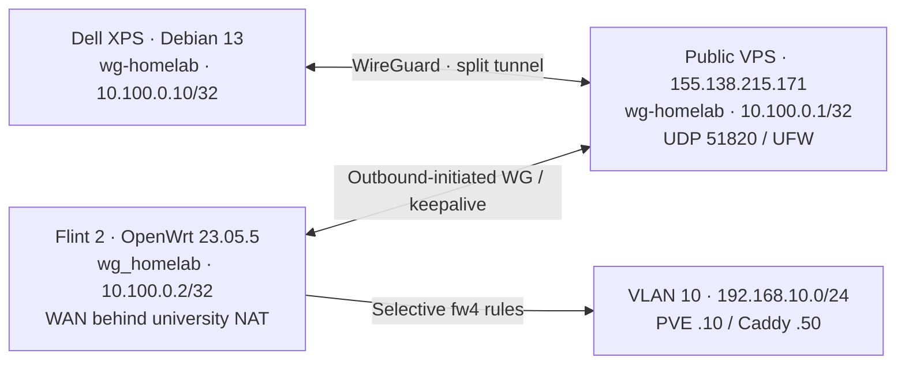

# VPN — remote WireGuard relay and planned Mullvad egress

**Remote access status:** deployed and verified 2026-10-25. **Outbound Mullvad:** planned; not deployed. This document describes the verified deployment, not a generic router-hosted VPN design.

## Why a public relay

The Flint 2 WAN is behind university NAT (`10.19.13.231` observed; upstream public egress `158.93.6.19`). Inbound UDP cannot be assumed reachable, so **the public VPS initiates no connection to the router**: the Flint 2 sends outbound WireGuard traffic to the VPS. The XPS also connects to the VPS. The VPS routes allowed traffic between its two peers. No router WAN port forward or router DDNS is required.



## Addressing and interface names

| Peer | Interface | Tunnel address | Function |
|---|---|---|---|
| Public VPS `Seth` | `wg-homelab` | `10.100.0.1/32` | Internet-reachable relay at `155.138.215.171:51820` |
| Flint 2 `flint2` | `wg_homelab` | `10.100.0.2/32` | Router / VLAN 10 gateway |
| Dell XPS | `wg-homelab` | `10.100.0.10/32` | Manually controlled remote client |

OpenWrt UCI uses `wg_homelab` (underscores), with `network.wg_homelab` as the interface and `network.wg_homelab_vps` as its `wireguard_wg_homelab` peer section. The firewall zone is `wg_homelab`. Linux `wg-quick` uses `wg-homelab` (hyphen) on the VPS and XPS. **Do not rename these independently without updating all peer and firewall references.**

### Public peer keys (never commit private keys)

| Peer | WireGuard public key |
|---|---|
| VPS | `YEojalfdlLOdslBtA4sSSSj3P1i2tZbDxXlVaqb1q3w=` |
| Flint 2 **rotated 2026-10-25** | `avBq92hcErfVZ4+rFSIfgAizHmfTBC6k5s8VGuVD9xQ=` |
| Dell XPS | `Bz/U2lJab8uLsoHblmm9bmik6XbT74fvfEPWjSRiUnA=` |

The Flint 2 key was rotated after the prior private key appeared in diagnostic output. The VPS peer was updated in place using `wg syncconf`, and Flint 2 was restarted with its new key. Its new public key, handshake, and five ICMP replies to the VPS were verified. Delete or securely restrict old router backup files containing the exposed key; never copy them to the repository.

## Routing and access policy

| Location | Peer AllowedIPs or route | Meaning |
|---|---|---|
| XPS → VPS | `10.100.0.0/24, 192.168.10.0/24` | Split tunnel: VPN peer addresses and Lab only; ordinary Internet uses local network |
| VPS → Flint 2 | `10.100.0.2/32, 192.168.10.0/24` | Lab traffic goes to router peer |
| VPS → XPS | `10.100.0.10/32` | Individual client route |
| Flint 2 → VPS | `10.100.0.1/32, 10.100.0.10/32` | Routes to relay and XPS; `route_allowed_ips=1` |

The router peer uses `persistent_keepalive=25` to preserve the upstream NAT mapping; the XPS peer also uses 25 seconds. VPS IPv4 forwarding is enabled via `/etc/sysctl.d/90-wireguard-forward.conf` (`net.ipv4.ip_forward=1`). **WireGuard AllowedIPs is routing/peer selection, not an authorization policy:** UFW and OpenWrt fw4 restrict actual access.

### Deployed access allowlist

| From | Destination | Protocol | Enforcement |
|---|---|---|---|
| XPS `10.100.0.10` | Flint 2 WG IP `10.100.0.2` | ICMP echo | OpenWrt explicit input rule; VPS routed rule |
| XPS | Proxmox `192.168.10.10` | TCP 22, 8006 | VPS UFW route allow and router `wg_homelab` → `lab` rules |
| XPS | Caddy `192.168.10.50` | TCP 443 | VPS UFW route allow and router `wg_homelab` → `lab` rules |
| XPS | Router DNS `192.168.10.1` | TCP/UDP 53 | VPS UFW route allow and router explicit input rule |
| VPS WG IP `10.100.0.1` | Flint 2 WG IP `10.100.0.2` | ICMP echo | Router explicit input rule |

VPS UFW defaults to **deny routed** and has six named-interface `wg-homelab` forwarding allowances, with no remaining `wgtest` allowances after 2026-10-25 cleanup. Its WAN allows UDP 51820 for WireGuard. On the Flint 2, zone `wg_homelab` uses `input=REJECT`, `output=ACCEPT`, `forward=REJECT` plus the rules above. The legacy identifiers were renamed to `network.wg_homelab_vps`, `firewall.wg_homelab`, `firewall.allow_vps_wg_ping`; the other rule identifiers remain `allow_xps_wg_ping`, `wg_xps_proxmox`, `wg_xps_caddy`, `wg_xps_dns`. This is **not** blanket access to VLAN 10, VLAN 20, VLAN 30, NAS, or all Proxmox services. Negative tests against unauthorized VLANs and ports are still pending.

## Host-side configuration and operations

### Public VPS (Debian 11)

- Config: `/etc/wireguard/wg-homelab.conf` (root only, includes secret material).
- Live interface: `wg-homelab` on UDP `51820`.
- Boot unit: `wg-quick@wg-homelab` **enabled** on 2026-10-25. The running interface was started manually with `wg-quick up`; reboot recovery has not yet been tested. Avoid `systemctl start` or `enable --now` against an already manually running interface.
- UFW allows required routed destinations on `wg-homelab`, not `wgtest`. Remove obsolete private-key-bearing `wgtest.conf` and backups after a verified recovery plan; ensure only the new unit is enabled.

```bash
# On VPS only — read-only checks
wg show wg-homelab
ip route get 192.168.10.10
systemctl is-enabled wg-quick@wg-homelab
ufw status verbose
```

### Flint 2 (OpenWrt 23.05.5)

- UCI config: `/etc/config/network`, interface `network.wg_homelab` and peer `network.wg_homelab_vps`.
- Firewall: `/etc/config/firewall`, zone `wg_homelab`, with targeted input/forwarding rules.
- Interface is netifd-managed; no `wg-quick` service is installed on OpenWrt.
- Configured peer endpoint: `155.138.215.171:51820`; route to public VPS goes out university WAN (`eth1`), not the tunnel.

```sh
# On Flint 2 only; do not print 'uci show network' (private key)
uci get network.wg_homelab.proto
uci get network.wg_homelab_vps
uci get firewall.wg_homelab.name
wg show wg_homelab
ip route show
fw4 check
ping -c 3 -I wg_homelab 10.100.0.1
```

### Dell XPS (Debian 13)

- Config: `/etc/wireguard/wg-homelab.conf` (root readable only).
- Existing NetworkManager, Wi-Fi configuration, `/etc/resolv.conf`, and local DNS manager are unchanged.
- `/usr/local/bin/vpn` provides `vpn on`, `vpn off`, `vpn toggle`, and `vpn status` by calling `wg-quick`; **the client is not automatic at boot**.
- VPS endpoint: `155.138.215.171:51820`. DNS: existing `/etc/hosts` entries below (not an automatic VPN DNS override).

```bash
vpn on
vpn status
ip route get 192.168.10.10    # should show dev wg-homelab
ping -c 3 10.100.0.1
ping -c 3 10.100.0.2
curl -sS -o /dev/null -w 'PVE %{http_code}\n' --max-time 10 https://pve.home.arpa:8006/
curl -sS -o /dev/null -w 'Grafana %{http_code}\n' --max-time 10 https://grafana.home.arpa/
curl -sS -o /dev/null -w 'Kuma %{http_code}\n' --max-time 10 https://uptime.home.arpa/
vpn off
```

The XPS `/etc/hosts` entries were set for `pve.home.arpa` → `.10`, `grafana.home.arpa` and `uptime.home.arpa` → `.50`, `nas.home.arpa` → `.170`, and `monitor.home.arpa` → `.158`, all in `192.168.10.0/24`. Presence of a hosts entry **does not imply firewall authorization** (NAS/monitor direct access is not approved). The router dnsmasq also answers internal FQDNs at `192.168.10.1`; an earlier remote DNS test succeeded after `dhcp.@dnsmasq[0].localservice=0` (see [DNS](dns.md)), but the XPS uses hosts entries so no resolver takeover is needed.

### Validation evidence (2026-10-25)

- Off-network XPS test from a non-lab connection: VPN **off** → no WG route / no peer replies / HTTPS requests failed; VPN **on** → immediate handshake and route via `wg-homelab`, Proxmox **200**, Grafana **302**, Kuma **302**.
- After interface rename and Flint 2 key rotation: XPS → Flint 2 **5/5 ICMP**, Proxmox **200**, Grafana **302**; Flint 2 → VPS **5/5 ICMP**, fresh handshakes and correct new router public key. Prior to key rotation Kuma also returned **302** after naming cleanup.
- TLS worked for Caddy-hosted Grafana and Kuma without `-k`. Missing raw historical telemetry during an unrelated Prometheus outage was resolved by starting its container; the event was tied to an October 22 `apt upgrade` restarting Docker/containerd, not WireGuard.

### Troubleshooting / recovery

1. Verify tunnel status/handshake on **each** machine via `wg show`, distinguishing an established interface from a current handshake.
2. On XPS, `ip route get 192.168.10.10` must route via `wg-homelab`; if VPN off, that route is absent.
3. On VPS, confirm UDP 51820 UFW input and six `wg-homelab` UFW routed allowances, `net.ipv4.ip_forward=1`, correct peer AllowedIPs, and `wg-quick@wg-homelab` enabled.
4. On Flint 2, run `fw4 check`, inspect interface/peer UCI names with **key-safe** `uci get`, and check keepalive, WAN default route, and peer endpoint.
5. If HTTPS works by IP but not hostname, inspect XPS `/etc/hosts` or query `dig @192.168.10.1 pve.home.arpa`; do not replace NetworkManager as a workaround.
6. Preserve external VPS/router SSH access during interface cutovers; update **both ends** for any peer-key rotation. Roll back using securely held local backups if needed, never by publishing backup configs.

## Security follow-ups

- [x] Change `wgtest` to `wg-homelab` on VPS and `wg_homelab` on Flint 2; clean UFW and UCI identifiers.
- [x] Rotate accidentally exposed Flint 2 private key and verify tunnel recovery.
- [x] Enable `wg-quick@wg-homelab` for VPS boot (reboot verification still outstanding).
- [ ] Test **denied** XPS→VLAN 20, VLAN 30, and unapproved VLAN 10 hosts/ports; inspect both IPv4 and IPv6 behavior.
- [ ] Validate automated recovery after VPS/router reboot during a maintenance window.
- [ ] Remove or securely restrict backups with old private keys; clean the stale UFW UDP 51820 comment (`temporary test`) without removing the port allowance.
- [ ] Audit router DNS exposure after relaxing dnsmasq `localservice`; WAN must remain unable to reach port 53.
- [ ] Plan VPS Debian 11 upgrade separately from the tunnel deployment.

## Outbound Mullvad — separate planned work

Mullvad routing is **not deployed**. It is tracked separately from this inbound remote access setup. The updated scope is selective egress for Uptime Kuma Telegram notifications and NAS traffic, **not automatic full-VLAN-20 tunneling**. Any future policy-based routes and leak-prevention rules must preserve the Flint 2→VPS UDP 51820 endpoint, the existing `wg_homelab` routes, and university network policies. Implement and validate this in a separate feature branch (`feat/mullvad-routing`).
