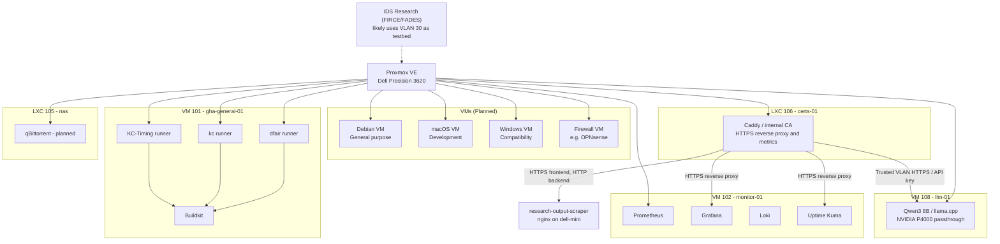

# Services

All services run on or through the **Dell Precision 3620 Proxmox node**
unless noted — `research-output-scraper` is the one exception, running
directly on `dell-mini` instead.

## Contents

- [Proxmox](proxmox.md) — hypervisor setup, VMs, GitHub Actions runner
- [NAS & Storage](nas.md) — qBittorrent, NAS software, HDD setup
- [GitHub Actions Runners](github-actions-runners.md) — KC/DFAIR/KC-Timing setup, safe restarts, manual deployment and nightly update checks
- [Monitoring](monitoring.md) — current and planned monitoring stack
- [Internal HTTPS / Caddy](caddy.md) — reverse proxy, internal CA, metrics and trust
- [Local GPU LLM](local-llm.md) — VM108, Quadro P4000 passthrough, Qwen3 8B, private HTTPS API and reboot recovery
- [IDS Research](ids-research.md) — dissertation research (FIRCE/FADES),
  likely uses this network's IoT VLAN as its real-world testbed
- [research-output-scraper](research-output-scraper.md) — CS researcher
  publication leaderboard, the one service that runs on `dell-mini`
  instead of Proxmox

## Services Overview

## Internal DNS

| Property | Value |
|---|---|
| Status | Operational |
| Host | GL.iNet Flint 2 |
| Software | OpenWrt dnsmasq |
| Namespace | `home.arpa` |
| Deployment | Router-native |
| Dependencies | Router availability |
| Primary clients | VLAN 10 and VLAN 20 |

DNS resolution and DHCP are managed directly by OpenWrt rather than a Proxmox VM or LXC.

The router maintains hostname records from DHCP leases and reservations, with explicit DNS records for statically addressed infrastructure.

### Infrastructure Services

| Service | Hostname | Access |
|---|---|---|
| Proxmox VE | `pve.home.arpa` | HTTPS port 8006 |
| Grafana host | `monitor.home.arpa` | Port 3000 |
| Uptime Kuma host | `monitor.home.arpa` | Port 3001 |
| CS publication leaderboard | `cs-leaderboard.home.arpa` | HTTPS 443 via Caddy → `dell-mini:80` |
| NAS LXC | `nas.home.arpa` | Service-dependent |
| GitHub Actions VM | `gha-general-01.home.arpa` | SSH port 22 |
| Local LLM API | `llm.home.arpa` | HTTPS port 443, Trusted VLAN + Bearer API key |

The NAS currently uses DHCP at `192.168.10.170`. A permanent reservation is recommended but has not yet been configured.

DNS resolution does not grant access between VLANs; OpenWrt firewall policies remain enforced.

For the full configuration, verified inventory, and troubleshooting procedures, see [Internal DNS](../networking/dns.md).

## Service Status

| Service | Type | Status | Priority |
|---|---|---|---|
| [GitHub Actions runners (DFAIR/KC/KC-Timing)](github-actions-runners.md) | 3x Docker containers on `gha-general-01` (VM 101, separate from proxmox itself) | ✅ Running | High |
| Monitoring (Prometheus/Grafana) | Docker, on `monitor-01` (VM 102) | ✅ Running | High |
| [Internal HTTPS / Caddy](caddy.md) | Caddy 2.6.2 on `certs-01` (LXC 106) | ✅ Running; hardening and dashboards pending | High |
| [research-output-scraper](research-output-scraper.md) | nginx + systemd on `dell-mini`; HTTPS via Caddy | ✅ Running; HTTPS verified 2026-10-21 | Medium |
| [qBittorrent](nas.md) | qBittorrent-nox 4.5.2 in NAS CT 105 | ✅ Running via Mullvad, HTTPS `torrent.home.arpa` | Medium |
| [NAS storage](nas.md) | CT 105 with bind-mounted HDD | ✅ CT/storage running; SMB/NFS management stack pending | Medium |
| Firewall VM | VM | 🔲 Planned | Low |
| Debian VM | VM | 🔲 Planned | Low |
| macOS VM | VM | 🔲 Planned | Low |
| Windows VM | VM | 🔲 Planned | Low |

## Mullvad-dependent services (2026-10-25)

- [NAS / qBittorrent](nas.md): CT 105, Mullvad-only PBR and WAN guard; Web UI via `torrent.home.arpa`.
- [Telegram proxy and DNS](telegram-proxy.md): CT 107, Tinyproxy allowlisting `api.telegram.org`, plus VPN-mode DNS for Trusted VLAN.
- [Monitoring](monitoring.md): Kuma upgraded to 2.5.7, Telegram DOWN/recovery alerts verified via CT 107.

See [Mullvad router operations](../networking/mullvad.md) for subnet-level routing and toggle details.
