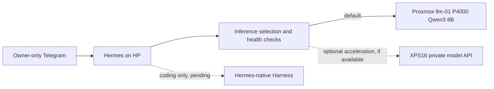

# Hermes gateway: verified HP baseline and inference design

**Status, 2026-10-29:** HP host baseline is verified. Hermes itself, Telegram, Harness integration, inference routing and XPS booster are **not yet deployed**. Tracking: [#85](https://github.com/sethbarrett50/home_lab_docs/issues/85).

## Completed HP baseline (#86)

- HP EliteBook 840 G2 (i5-5300U, 16 GiB RAM, 240 GB SATA SSD), `hp-lap` on VLAN 10, `192.168.10.147` DHCP reservation.
- Debian 13.7 Trixie, headless, Linux `6.12.113+deb13-amd64`. The known-working `6.1.0-54-amd64` kernel remains installed as a fallback.
- Root LUKS2 `/dev/sda5` → `sda5_crypt` → LVM. Remote LUKS unlock from XPS **successfully tested after Trixie reboot** using Dropbear in initramfs, TCP 2222, `IP=dhcp`, `e1000e` driver and forced `cryptroot-unlock`. OpenWrt rule admits only XPS `192.168.20.173` to early-boot port. Unlock still requires a human passphrase; **not automatic recovery after power loss**.
- System user `hermes`, UID 999, nologin shell; private writable `/home/hermes/.hermes`, `/home/hermes/workspaces`, `/var/lib/hermes`, `/var/log/hermes`. No Hermes runtime installed yet.
- Docker CE 29.9.2 / containerd 2.4.2 from official Trixie repository, active alongside SSH, networkd, resolved and smartmontools. `systemctl is-system-running` = running, zero failed units, `dpkg --audit` clean, no upgrades pending.
- Removed Bluetooth, Avahi, Exim4 and UDisks2; disabled LLMNR and mDNS. Normal-boot externally listening TCP is only SSH 22; resolver binds loopback port 53.
- `/boot` is only 455 MiB with 212 MiB free. **Keep fallback Linux 6.1 kernel** and review capacity before future kernel installs. Battery charging (43% at last check); backup runtime not verified.
- Sensitive configuration-only snapshots stored on XPS at `~/backups/hp-lap/hp-pre-trixie-config.tar.gz` and `hp-remote-unlock-working.tar.gz`. **Not a complete system backup or tested restore.**

### Encrypted reboot recovery

From XPS, at the LUKS unlock stage:

```bash
ssh -tt -p 2222 -i ~/.ssh/hp-luks-unlock \
  -o IdentitiesOnly=yes \
  -o UserKnownHostsFile="$HOME/.ssh/known_hosts_hp_initramfs" \
  root@192.168.10.147
```

Known initramfs **server host-key** fingerprint: `SHA256:JGNqd08STN5k3aiD8HCjvNNUTzEav5wX6xXyjxpuv3I`. Verify any changed host key out-of-band. Enter LUKS passphrase interactively. After disconnect, reconnect normally via SSH port 22. If the remote unlock path fails, use the physical console; do not reboot repeatedly. Keep credentials and private keys **out of Git**.

```bash
uname -r
systemctl is-system-running
systemctl --failed --no-pager
systemctl is-active ssh systemd-networkd systemd-resolved docker containerd smartmontools
sudo cryptsetup status sda5_crypt
sudo dpkg --audit
df -h /boot
```

## Target: Proxmox as default, XPS16 as an optional booster



**Primary (always-on):** Proxmox VM108 `llm-01` (`192.168.10.162`) serves llama.cpp / Qwen3 8B, Quadro P4000 8 GB, 4096 context, one concurrent slot. User-facing endpoint: `https://llm.home.arpa/v1` through Caddy `certs-01`; bearer API key required. **Presently Caddy only allows Trusted VLAN 20. HP VLAN 10 access is NOT verified/authorized.** For HP integration, explicitly add only HP source `192.168.10.147` to the Caddy allowlist, retain TLS/authentication, and retain `llm-01`'s nftables restriction allowing backend TCP 8080 only from Caddy. Negative-test other lab clients. See [local-llm.md](local-llm.md).

**Booster (optional):** XPS16 is at homelab WireGuard `10.100.0.10`. XPS→lab is tested; **HP→XPS route and firewall are not yet tested**. Expose to HP **only the dedicated LLM inference API endpoint**, preferably authenticated and encrypted. Explicitly deny HP access to XPS SSH, file shares, desktop services, Docker socket and general LAN ports. Enforce the restriction at VPS/Flint/XPS firewalls and service binding. No XPS connection is required for normal Hermes usage. Route eligible larger/faster inference tasks to XPS only while healthy; use Proxmox when XPS is offline; implement bounded retries, timeouts and interruption-safe fallback.

**Hermes Harness:** all coding workflows must ultimately go through native Hermes skills/commands with supervised Harness delegation, not a parallel CLI frontend. Harness remains a separate repository; do not declare enforcement complete until integration is tested.

## Remaining tracked work

- [#87](https://github.com/sethbarrett50/home_lab_docs/issues/87): HP→XPS private inference-only WireGuard path and negative security tests.
- [#88](https://github.com/sethbarrett50/home_lab_docs/issues/88): persistent systemd Hermes gateway and owner-only Telegram.
- [#89](https://github.com/sethbarrett50/home_lab_docs/issues/89): Proxmox-primary inference; optional XPS boost/fallback back to Proxmox.
- [#90](https://github.com/sethbarrett50/home_lab_docs/issues/90): HP-specific Mullvad public egress and fail-closed policy.
- [#91](https://github.com/sethbarrett50/home_lab_docs/issues/91): Hermes-native Harness enforcement.
- [#92](https://github.com/sethbarrett50/home_lab_docs/issues/92): metrics, negative testing and end-to-end recovery.

**Do not infer** that existing Mullvad for NAS/Telegram proxy also covers HP. Keep homelab WireGuard private routing separate from public Mullvad egress. No secrets, user IDs, keys, tokens or passphrases in repository files or GitHub issues.
