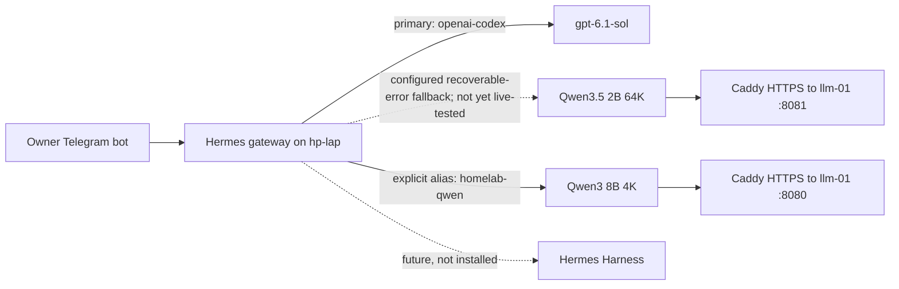

# Hermes gateway: HP baseline, live Codex/Telegram and local fallback

**Status, 2026-10-29:** HP baseline, persistent Hermes gateway, Codex OAuth primary, owner Telegram messaging, authenticated Qwen3.5 native alias, and local terminal smoke execution are observed. **Automatic primary-to-local failover, reliable local coding tools, Harness integration and XPS booster are not yet qualified.** See [Harness deployment readiness](hermes-harness-deployment.md). Historical tracking: [#85](https://github.com/sethbarrett50/home_lab_docs/issues/85).

## Completed HP baseline (#86)

- HP EliteBook 840 G2 (i5-5300U, 16 GiB RAM, 240 GB SATA SSD), `hp-lap` on VLAN 10, `192.168.10.147` DHCP reservation.
- Debian 13.7 Trixie, headless, Linux `6.12.113+deb13-amd64`. The known-working `6.1.0-54-amd64` kernel remains installed as a fallback.
- Root LUKS2 `/dev/sda5` → `sda5_crypt` → LVM. Remote LUKS unlock from XPS **successfully tested after Trixie reboot** using Dropbear in initramfs, TCP 2222, `IP=dhcp`, `e1000e` driver and forced `cryptroot-unlock`. OpenWrt rule admits only XPS `192.168.20.173` to early-boot port. Unlock still requires a human passphrase; **not automatic recovery after power loss**.
- System user `hermes`, UID 999, nologin shell; private writable `/home/hermes/.hermes`, `/home/hermes/workspaces`, `/var/lib/hermes`, `/var/log/hermes`. Hermes runtime subsequently installed; account isolation retained.
- Docker CE 29.9.2 / containerd 2.4.2 from official Trixie repository, active alongside SSH, networkd, resolved and smartmontools. `systemctl is-system-running` = running, zero failed units, `dpkg --audit` clean, no upgrades pending.
- Removed Bluetooth, Avahi, Exim4 and UDisks2; disabled LLMNR and mDNS. Normal-boot externally listening TCP is only SSH 22; resolver binds loopback port 53.
- `/boot` is only 455 MiB with 212 MiB free. **Keep fallback Linux 6.1 kernel** and review capacity before future kernel installs. Battery charging (43% at last check); backup runtime not verified.
- Sensitive configuration-only snapshots stored on XPS at `~/backups/hp-lap/hp-pre-trixie-config.tar.gz` and `hp-remote-unlock-working.tar.gz`. **Not a complete system backup or tested restore.**

### Encrypted reboot recovery

From XPS, at the LUKS unlock stage:

```bash
ssh -tt -p 2222 -i ~/.ssh/hp-luks-unlock \
  -o IdentitiesOnly=yes \
  -o UserKnownHostsFile="$HOME/.ssh/known_hosts_hp_initramfs" \
  root@192.168.10.147
```

Known initramfs **server host-key** fingerprint: `SHA256:JGNqd08STN5k3aiD8HCjvNNUTzEav5wX6xXyjxpuv3I`. Verify any changed host key out-of-band. Enter LUKS passphrase interactively. After disconnect, reconnect normally via SSH port 22. If the remote unlock path fails, use the physical console; do not reboot repeatedly. Keep credentials and private keys **out of Git**.

```bash
uname -r
systemctl is-system-running
systemctl --failed --no-pager
systemctl is-active ssh systemd-networkd systemd-resolved docker containerd smartmontools
sudo cryptsetup status sda5_crypt
sudo dpkg --audit
df -h /boot
```

## Live model routing and gateway (2026-10-29)



- Hermes Agent: `v0.22.5+2971.ga938f00` (2026.9.24), installed for system user `hermes` under `/home/hermes/src/hermes-agent`.
- Persistent systemd unit: `hermes-gateway-7944f2ae.service`, enabled/active after restart; `User=hermes`, `WorkingDirectory=/home/hermes/.hermes`. Telegram user messaging was confirmed against the Codex primary.
- Primary model: `gpt-6.1-sol` via `openai-codex`, OAuth integration. Do not store tokens in this repository.
- Configured fallback: `qwen35-2b`, `provider: custom`, `base_url: https://llm-long.home.arpa/v1`, `key_env: LOCAL_LLM_API_KEY`; `hermes fallback list` confirms configuration, **but no induced failover has been demonstrated**.
- Named alias `homelab-long` uses the same 64K endpoint and key env; `hermes chat --model homelab-long` returned the requested text. The existing `homelab-qwen` alias points to the 8B endpoint.
- **Credential behavior:** explicit `--provider custom` and injecting `OPENAI_API_KEY` produced HTTP 401; selecting the `homelab-long` alias with `key_env` succeeded. Prefer the verified alias path and do not pass keys as CLI arguments.
- Qwen3.5 2B executed `pwd` and `uname -s` through Hermes terminal tooling in a hermes-owned workspace, but other attempts produced invalid tool names, deferred-tool discovery loops, or command policy refusals. Tool-dependent fallback is **not production-qualified**.
- `sudo -u hermes -H` can inherit the invoking working directory, e.g. `/home/pooltab` (0700). `cd /home/hermes` or use `--in /home/hermes/local-agent-smoke` to prevent terminal failures. Do not loosen either home directory's permissions.
- `/home/hermes/.hermes/.env` holds credentials (mode 0600); never print or commit. `/home/hermes/.hermes/config.yaml` controls routing; preserve a 0600 backup before edits.

### Network, DNS and public egress

- HP 192.168.10.147 is explicitly permitted at Caddy alongside Trusted VLAN 20, for `llm.home.arpa` and `llm-long.home.arpa`. Backend ports 8080/8081 on llm-01 are Caddy-source-only using nftables; requests still require bearer authentication.
- HP persistent `systemd-networkd` DNS override: `/etc/systemd/network/10-wired.network.d/20-hermes-dns.conf`; DNS `192.168.10.171` (CT107), `Domains=~.`, `UseDNS=no` for DHCPv4/v6. CT107 permits HP TCP/UDP 53 through its `trusted-dns-access.service`, resolves `home.arpa` via Flint2 and public domains through Mullvad. Changes were tested persistently, not against a full cold boot.
- HP public HTTP egress was observed via a Mullvad exit IP. Do not infer all traffic is fail-closed or boot-order safe without separate tests. Avoid routing private `home.arpa` traffic through a public VPN.

### Read-only operator checks

```bash
# Run on hp-lap; never print token values.
systemctl is-active hermes-gateway-7944f2ae.service
systemctl show hermes-gateway-7944f2ae.service -p User -p WorkingDirectory
sudo -u hermes -H /home/hermes/.local/bin/hermes fallback list
getent hosts llm.home.arpa llm-long.home.arpa
sudo journalctl -u hermes-gateway-7944f2ae.service -n 40 --no-pager
```

**Booster (optional):** XPS16 is at homelab WireGuard `10.100.0.10`. XPS→lab is tested; **HP→XPS route and firewall are not yet tested**. Expose to HP **only the dedicated LLM inference API endpoint**, preferably authenticated and encrypted. Explicitly deny HP access to XPS SSH, file shares, desktop services, Docker socket and general LAN ports. Enforce the restriction at VPS/Flint/XPS firewalls and service binding. No XPS connection is required for normal Hermes usage. Route eligible larger/faster inference tasks to XPS only while healthy; use Proxmox when XPS is offline; implement bounded retries, timeouts and interruption-safe fallback.

**Hermes Harness:** all coding workflows must ultimately go through native Hermes skills/commands with supervised Harness delegation, not a parallel CLI frontend. Harness remains a separate repository; do not declare enforcement complete until integration is tested.

## Remaining tracked work

- [#87](https://github.com/sethbarrett50/home_lab_docs/issues/87): HP→XPS private inference-only WireGuard path and negative security tests.
- [#88](https://github.com/sethbarrett50/home_lab_docs/issues/88): persistent systemd Hermes gateway and owner-only Telegram.
- [#89](https://github.com/sethbarrett50/home_lab_docs/issues/89): Proxmox-primary inference; optional XPS boost/fallback back to Proxmox.
- [#90](https://github.com/sethbarrett50/home_lab_docs/issues/90): HP-specific Mullvad public egress and fail-closed policy.
- [#91](https://github.com/sethbarrett50/home_lab_docs/issues/91): Hermes-native Harness enforcement.
- [#92](https://github.com/sethbarrett50/home_lab_docs/issues/92): metrics, negative testing and end-to-end recovery.

**HP Mullvad egress was subsequently verified**, but fail-closed behavior and post-reboot recovery have not been qualified. Keep homelab WireGuard private routing separate from public Mullvad egress. No secrets, user IDs, keys, tokens or passphrases in repository files or GitHub issues.
