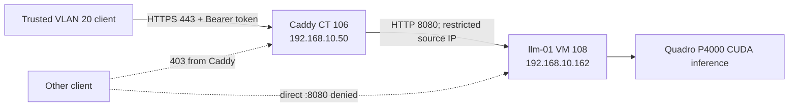

# Local GPU LLM — llm-01 (Phase 4)

First endpoint deployed and validated **2026-10-27**; second 64K endpoint and dual-model operation validated **2026-10-29**. A Debian 13 VM on the Dell Precision 3620 Proxmox host serves a private, authenticated, OpenAI-compatible LLM API. GPU passthrough, CUDA inference, HTTPS access, client rejection, VM guest reboot recovery, and a 4,096-token context load were observed. **A full Proxmox host restart and recovery was not tested.**

## Inventory and deployment

| Setting | Value |
|---|---|
| Proxmox guest | VM **108**, `llm-01`, Debian 13 (Trixie), kernel `6.12.113+deb13-amd64` |
| Guest resources | 4 vCPU (`host`), 6,144 MiB RAM, 100 GB disk (`ssd-1tb` thin storage), Q35 / OVMF, VirtIO network on `vmbr0` |
| Address | `192.168.10.162/24`, gateway `192.168.10.1`, DHCP reservation for `BC:24:11:34:49:AC` |
| Host passthrough | `hostpci0: 0000:01:00.0,pcie=1` (P4000 graphics); `hostpci1: 0000:01:00.1,pcie=1` (P4000 audio) |
| GPU | NVIDIA Quadro P4000, 8 GiB Pascal (CUDA architecture 61) |
| Driver and CUDA | Debian NVIDIA driver `550.163.01`, CUDA toolkit `12.4.131` |
| Runtime | `llama.cpp` build `b11942-338fce651`, CUDA backend enabled, `CMAKE_CUDA_ARCHITECTURES=61` |
| Models | Qwen3 8B Q4_K_M (4K context, 8080) and Qwen3.5 2B Q4_K_M (64K context, 8081); original Qwen3 8B SHA-256 verified at install |
| Backends | `192.168.10.162:8080` (8B) and `:8081` (2B); HTTP **only from Caddy**; Bearer token required |
| User-facing URLs | `https://llm.home.arpa/v1` (8B) and `https://llm-long.home.arpa/v1` (2B), TLS via Caddy `certs-01` (`192.168.10.50`) |
| Allowed front-end clients | Trusted VLAN `192.168.20.0/24` and HP `192.168.10.147/32`, enforced by Caddy `remote_ip` matcher |
| API credentials | `/home/pooltab/.config/llama-server/api-keys`, mode `0600`; **never commit, print in logs, or distribute in docs** |
| Context and concurrency | Qwen3 8B: 4,096; Qwen3.5 2B: 65,536 with q8 KV; both `--parallel 1`, `--gpu-layers 99`, 4 CPU threads |

The host's IOMMU group contains the P4000 graphics, its audio function and their upstream PCI bridge, without other unrelated endpoints. The host has a separate Intel integrated GPU. On initial VM start, Proxmox emitted a PCI reset warning but VFIO assignment succeeded, and the guest driver identified the passed-through P4000. No ACS override or Proxmox BIOS/bootloader changes were needed in this session. **Do not assume full host-reboot or subsequent cold-start behavior has been validated.**

## Traffic and security



1. Caddy's `llm.home.arpa` and `llm-long.home.arpa` sites use `tls internal`, allow `remote_ip 192.168.20.0/24` and `192.168.10.147`, proxy to `192.168.10.162:8080` and `:8081` respectively, and return 403 otherwise. Other Caddy virtual hosts remain unchanged.
2. `llm-01` nftables uses an `inet filter` input chain with `policy accept`; loopback is allowed, IPv6 TCP/8080 and TCP/8081 are dropped, and IPv4 TCP/8080 and TCP/8081 are dropped unless the source is `192.168.10.50`. This is an **API-specific restriction**, not a host-wide default-deny firewall. `nftables.service` is enabled.
3. `llama-server` enforces an API key via `--api-key-file`, disables its Web UI, and configures conservative CORS options. Caddy forwards the Bearer token; it does not store the key.
4. Traffic on the **Caddy-to-guest segment is unencrypted HTTP**, including the Bearer token. Restricting source IPs does not encrypt that hop. For a stronger threat model, deploy encrypted upstream transport and evaluate internal lateral-movement risks.
5. SSH on `llm-01` remains available; do not turn this scoped port rule into a blanket firewall policy without separately planning SSH access.

Observed tests: the Trusted laptop received **401** without an API key and a correct completion with one; a request to Caddy from `certs-01` received **403**; direct laptop access to `192.168.10.162:8080` failed (`curl` HTTP 000 / connection refused). The last outcome establishes failed connectivity in that test but is not on its own a packet-drop trace. Negative tests across every VLAN/IPv6 path are not complete.

### Caddy configuration excerpt (`certs-01`)

```caddyfile
llm.home.arpa {
    tls internal
    encode zstd gzip

    @trusted remote_ip 192.168.20.0/24

    handle @trusted {
        reverse_proxy 192.168.10.162:8080
    }

    respond 403
}
```

On `certs-01`, commands run as root (`sudo` is not installed). Back up `/etc/caddy/Caddyfile`; validate with `caddy validate --config /etc/caddy/Caddyfile`, then reload with `systemctl reload caddy`. Do not overwrite the other services' Caddyfile blocks. The public DNS record `llm.home.arpa` points at **Caddy**, not at the backend.

### Guest firewall configuration (`llm-01`)

```nft
#!/usr/sbin/nft -f
flush ruleset

table inet filter {
    chain input {
        type filter hook input priority filter; policy accept;
        iifname "lo" accept
        meta nfproto ipv6 tcp dport 8080 drop
        ip saddr != 192.168.10.50 tcp dport 8080 drop
    }
    chain forward { type filter hook forward priority filter; policy accept; }
    chain output  { type filter hook output  priority filter; policy accept; }
}
```

**Historical reference (2026-10-27):** this snippet shows the original 8080-only rule; the 2026-10-29 live nftables configuration additionally protects TCP 8081 with the same Caddy-source restriction. Do not apply the historical snippet unchanged to the dual-model deployment. Validate with `sudo /usr/sbin/nft -c -f /etc/nftables.conf` before applying; inspect live rules with `sudo /usr/sbin/nft list ruleset`. Keep SSH open during firewall modifications.

## Service management and recovery

- Unit: `/etc/systemd/system/llama-server.service` (enabled).
- Readiness override: `/etc/systemd/system/llama-server.service.d/10-readiness.conf`.
- Readiness script: `/usr/local/sbin/wait-llama-ready.sh`.
- Runtime: `/home/pooltab/src/llama.cpp/build/bin/llama-server`.
- Model file: `/home/pooltab/models/qwen3-8b/Qwen3-8B-Q4_K_M.gguf`.
- API key: `/home/pooltab/.config/llama-server/api-keys` (mode `0600`, not included here).

The `ExecStartPre` script checks the reserved IPv4 address on `ens18` and invokes `llama-server --list-devices`, checking for `CUDA0: Quadro P4000`; it retries up to 60 times with two-second sleeps, using a 10-second timeout for each device probe. The override includes `TimeoutStartSec=180`; the main unit uses `Restart=on-failure` and `RestartSec=10`. The readiness script is documented in a separate [reference file](llm-01/wait-llama-ready.sh); review it before deployment to another machine.

The initial guest reboot produced an early bind failure followed by a CUDA initialization failure and unintended CPU fallback. The readiness override was introduced to avoid those races. On the subsequent guest reboot, startup waited approximately 46 seconds, then detected the GPU, loaded the model, and held ~4.9 GiB of VRAM. **The guard only verifies pre-start GPU visibility; it cannot guarantee that CUDA loading never fails later or prevent every CPU fallback.** Monitor model residency and request latency.

```bash
# Execute inside llm-01 as pooltab
systemctl status llama-server --no-pager
sudo journalctl -u llama-server -b -n 80 --no-pager
nvidia-smi
/home/pooltab/src/llama.cpp/build/bin/llama-server --list-devices
sudo ss -ltnp | grep ':8080'
systemctl is-active nftables llama-server
sudo /usr/sbin/nft list ruleset

# For controlled service restarts
sudo systemctl restart llama-server
```

Do not infer GPU utilization from `systemctl is-active` alone. For a healthy idle model at 4,096 context, `nvidia-smi` reported about **5,235 MiB** used (llama-server ~5,230 MiB). If it shows only a few MiB after `model loaded`, investigate CUDA warnings and CPU fallback. A clean service start can show low VRAM for the first seconds while the model loads. `modinfo nvidia` may report not found with Debian's packaged DKMS driver; use `sudo /usr/sbin/modinfo nvidia-current` for inspection. The guest's `nouveau` driver was disabled via `/etc/modprobe.d/disable-nouveau.conf`; do not modify the host's driver based on guest results.

### Service configuration reference

The active unit sets `User=pooltab`, `WorkingDirectory=/home/pooltab/src/llama.cpp`, and runs the CUDA-built binary with the following key arguments:

```text
--model /home/pooltab/models/qwen3-8b/Qwen3-8B-Q4_K_M.gguf
--alias qwen3-8b
--host 192.168.10.162 --port 8080
--ctx-size 4096 --gpu-layers 99 --parallel 1 --threads 4
--jinja --no-webui
--cors-origins localhost --no-cors-credentials
--api-key-file /home/pooltab/.config/llama-server/api-keys
```

Back up the systemd unit before editing, then run `sudo systemctl daemon-reload` and `sudo systemd-analyze verify llama-server.service`. The unit and override should be root-owned, mode `0644`; the script `0755`; the key remains `0600`.

### Client example (Trusted VLAN)

```bash
# The client's trust store must contain Caddy's internal public root CA.
# Enter key privately; do not store it in shell history or commit it.
read -rsp 'LLM API key: ' API_KEY; echo
curl -sS --max-time 120 \
  -H "Authorization: Bearer $API_KEY" \
  -H 'Content-Type: application/json' \
  https://llm.home.arpa/v1/chat/completions \
  -d '{"model":"qwen3-8b","messages":[{"role":"user","content":"Reply with one sentence. /no_think"}],"max_tokens":80}'
unset API_KEY
```

For a deliberately unauthenticated smoke test, `curl -sS -o /dev/null -w '%{http_code}\n' https://llm.home.arpa/v1/models` should return **401** from an allowed client. For an untrusted source it should return **403** at Caddy. Prefer a trusted CA over `curl -k` in normal use. Never expose the backend port to clients merely to simplify integration.

## Observed benchmarks

| Setting | Result |
|---|---|
| Qwen3 8B `Q4_K_M`, 2,048 context | ~4,945 MiB GPU memory; generation ~28–29 tokens/sec |
| Qwen3 8B `Q4_K_M`, 4,096 context | ~5,235 MiB GPU memory; generation **29.15 tokens/sec** over authenticated HTTPS, 93 tokens generated |
| 4,096 context API test | 28 prompt tokens, 93 completion tokens; ~161 prompt tokens/sec and ~29.15 completion tokens/sec |
| Guest restart | GPU-backed server recovered automatically after 23 readiness attempts |

These are point-in-time single-user results; `--parallel 1` means one slot. Model quality, longer prompt performance, thermals under prolonged load, and full-host recovery remain unbenchmarked.

## Operational follow-ups

- [ ] Test full **Proxmox host** reboot/VFIO assignment and recovery in a maintenance window; do not reboot the host solely for this validation.
- [ ] Add uptime, endpoint readiness, GPU memory/utilization, and CPU-fallback monitoring with suitable alerts.
- [ ] Decide how to rotate/store API keys securely; avoid secrets in Git, logs or tickets.
- [ ] Consider encrypted Caddy-to-VM upstream traffic and stronger source restrictions if new clients or trust boundaries are added.
- [ ] Review driver updates for Pascal GPU support and security; a successful current build is not a promise of compatibility with newer CUDA releases.
- [ ] Evaluate longer contexts, model upgrades, GPU resource headroom and sustained-load performance separately.
- [ ] Verify whether remote VPN clients should be allowed; not included in Phase 4 access policy.

## Second endpoint: Qwen3.5 2B / 64K (observed 2026-10-29)

The second enabled systemd service is `llama-qwen35-2b.service` on `192.168.10.162:8081`. Model file: `/home/pooltab/models/qwen3.5-2b/Qwen3.5-2B-Q4_K_M.gguf` (1,280,835,840 bytes). Its active arguments were tested with `--alias qwen35-2b --ctx-size 65536 --cache-type-k q8_0 --cache-type-v q8_0 --gpu-layers 99 --parallel 1 --threads 4 --jinja --reasoning off --no-webui --api-key-file /home/pooltab/.config/llama-server/api-keys`. The endpoint uses the same Caddy TLS/root CA and backend bearer-key mechanism as the original 8B service.

The model was tested at 16K/32K/64K configured allocation, and a real 16,040-token prompt retrieval succeeded. Full 64K-input retrieval has **not** been demonstrated. The `--reasoning off` setting was required to obtain normal final answer text in prior checks.

| GPU memory snapshot (both services running) | Observed |
|---|---:|
| Qwen3 8B / 8080 | 5,230 MiB |
| Qwen3.5 2B / 8081 | 1,966 MiB |
| Total NVIDIA memory allocated | 7,201 MiB of 8,192 MiB |
| Unallocated at snapshot | approximately 991 MiB |

At that snapshot llm-01 had ~3.9 GiB available system RAM and 73 GiB disk available. These are point-in-time measurements; VRAM headroom is insufficient to assume a third model can safely remain resident. There is currently **no Harness-managed model rotation**.

### Safe dual-model inventory and checks

```bash
# On llm-01; read-only checks.
systemctl is-active llama-server.service llama-qwen35-2b.service nftables.service
systemctl is-enabled llama-server.service llama-qwen35-2b.service
nvidia-smi
sudo ss -ltnp | grep -E ':8080|:8081'
sudo nft list ruleset
# On an allowlisted, CA-trusting client: 401 without a token is expected.
curl -sS -o /dev/null -w '%{http_code}\\n' https://llm-long.home.arpa/v1/models
```

Backend firewall and Caddy configuration must preserve **both** ports and hostnames, and any future GPU scheduler must preserve pinned, in-use services. Read [Harness deployment readiness](hermes-harness-deployment.md) for the proposed hybrid resident/switchable model design.

### Validation boundaries

- The 8B endpoint reports a 4,096-token context and was rejected by Hermes native agent execution requiring at least 64K. Do not advertise a fictitious 64K context to satisfy this check.
- Hermes `homelab-long` custom alias with `key_env: LOCAL_LLM_API_KEY` successfully performed native chat, and executed `pwd` and `uname -s` in controlled tests. Other tool tasks failed from schema mistakes, discovery loops and a policy block; it is not a reliable autonomous coding worker yet.
- Automatic Codex-to-local failover, double-service recovery after llm-01 guest reboot, and full Proxmox host reboot remain unverified.
- Caddy-to-guest HTTP remains unencrypted, including bearer token transit. Backend source filtering is not encryption.

## Monitoring status (2026-10-29)

Two Uptime Kuma HTTP monitors on `monitor-01` were reported green for `https://llm.home.arpa/v1/models` and `https://llm-long.home.arpa/v1/models`, accepting the intentionally unauthenticated **401** response. Caddy's per-site `@trusted remote_ip` was extended by **192.168.10.158/32** for monitoring in addition to Trusted VLAN and `hp-lap`; the backend API restrictions were not relaxed. This checks HTTP availability/auth enforcement, not successful inference.

A read-only [NVIDIA SMI Prometheus exporter](gpu-monitoring/nvidia-smi-exporter.py) is running as `nvidia-smi-exporter.service` via systemd `DynamicUser=yes`, bound to `192.168.10.162:9835`. `llm-01` nftables drops IPv6 to TCP9835 and IPv4 from sources other than Prometheus host `192.168.10.158`. Existing restrictions on 8080/8081 remain. `monitor-01` scrapes job `llm-01-gpu` every 15 seconds; `promtool` validation passed, target health is **up**, and Prometheus queried 7.03 GiB VRAM used with both servers resident. Dashboard updates are in [Infra Overview](dashboards/infra-overview.json).

**Not yet verified:** automated GPU/LLM alerts, actual authenticated recurring inference health checks, dynamic model rotation, or live Grafana rendering of the amended dashboard.
