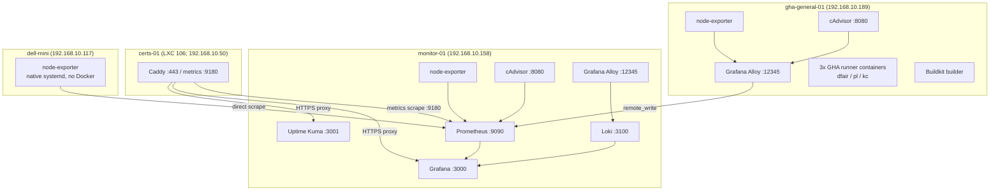

# Monitoring

## Current State

Deployed via Docker on two VMs, plus a native (non-Docker) node-exporter
on `dell-mini`, and Caddy metrics from `certs-01`. The Infrastructure
Overview dashboard has been rebuilt; an updated repository dashboard JSON now
includes a proposed Caddy row, but its import/rendering in live Grafana has not
yet been verified. Related work is tracked in issues
[#3](https://github.com/sethbarrett50/home_lab_docs/issues/3)–[#8](https://github.com/sethbarrett50/home_lab_docs/issues/8),
[#43](https://github.com/sethbarrett50/home_lab_docs/issues/43) for
dell-mini specifically.

## Actual Stack



## Components (as deployed)

| Container | Host | Port | Role |
|---|---|---|---|
| `grafana` | monitor-01 | 3000 | Visualization — Infrastructure Overview dashboard has been rebuilt; see [Dashboard Rebuild Status](#dashboard-rebuild-status) |
| `prometheus` | monitor-01 | 9090 | Metrics store. **Not** 3001 — that's Kuma (see below, was documented wrong) |
| `uptime-kuma` | monitor-01 | 3001 | Uptime/status checks; existing research-output-scraper monitors documented in [research-output-scraper.md](research-output-scraper.md#monitoring). Docker DNS pinned to `192.168.10.1`. Added internal-CA trust via `NODE_EXTRA_CA_CERTS` and read-only certificate mount (2026-10-20); new Grafana/Proxmox HTTPS monitor status not yet verified. |
| `loki` | monitor-01 | 3100 | Log aggregation |
| `alloy` | monitor-01 + gha-general-01 | 12345 | Unified telemetry collector — ships node-exporter/cAdvisor data to Prometheus/Loki |
| `cadvisor` | monitor-01 + gha-general-01 | 8080 | Per-container CPU/mem/network metrics |
| `node-exporter` | monitor-01 + gha-general-01 | — | Host-level CPU/mem/disk metrics |
| `node_exporter` (native, not a container) | dell-mini | 9100 | Host-level CPU/mem/disk metrics — scraped directly by Prometheus, no Alloy (dell-mini doesn't run Docker) |
| `dfair-gha-runner-local`, `pl-gha-runner-local`, `kc-gha-runner-local` | gha-general-01 | — | The 3 self-hosted GitHub Actions runners |
| `buildx_buildkit_builder-*` | gha-general-01 | — | Buildkit builder for the runners |

**Fixed (was issue #3):** all scrape targets were still pointed at
pre-migration `192.168.1.x` IPs (proxmox's target was literally still
`192.168.1.197`, its old flat-network address) — a direct side effect of the
VLAN migration earlier this session. Fixed by updating
`/opt/monitoring/prometheus/prometheus.yml` on monitor-01 to the current
`192.168.10.x` addresses and restarting the `prometheus` container. All 7
configured targets (prometheus, monitor-01-node/-containers,
gha-general-01-node/-containers, proxmox-node, dell-mini-node) are now
healthy.

## Caddy and internal HTTPS monitoring (2026-10-20)

Caddy runs on `certs-01` (LXC 106, `192.168.10.50`); full configuration and CA handling are documented in [Internal HTTPS / Caddy](caddy.md). Prometheus runs in Docker on `monitor-01` and reads `/opt/monitoring/prometheus/prometheus.yml` (bind-mounted read-only to `/etc/prometheus/prometheus.yml`). Added one scrape job alongside existing jobs:

```yaml
  - job_name: "caddy"
    scrape_interval: 15s
    metrics_path: /metrics
    static_configs:
      - targets:
          - "192.168.10.50:9180"
```

`promtool check config` passed, the lifecycle reload succeeded, and the target API reported `health: up` with `up{job="caddy"} = 1` and no scrape error. Existing seven targets remain configured; **eight** targets are now configured including Caddy. Caddy exposes upstream health and HTTP metrics. The Prometheus API was rechecked on 2026-10-20: `up{job="caddy"} = 1`, and both `caddy_reverse_proxy_upstreams_healthy` series (`192.168.10.158:3000` and `192.168.10.158:3001`) returned `1`. The values show successful scraping and Caddy-reported upstream state, not verified end-to-end application health.

**Uptime Kuma** (Docker Compose at `/opt/monitoring/compose.yml`) retains its named `/app/data` volume and router DNS (`192.168.10.1`). The service additionally sets:

```yaml
    environment:
      NODE_EXTRA_CA_CERTS: /etc/homelab-ca/root.crt
    volumes:
      # Existing uptime-kuma-data:/app/data mount is retained
      - /opt/monitoring/certs/homelab-root-ca.crt:/etc/homelab-ca/root.crt:ro
```

`/opt/monitoring/certs/homelab-root-ca.crt` is a verified copy of the **public** internal CA certificate; `NODE_EXTRA_CA_CERTS` and the mount were confirmed inside the running Uptime Kuma **1.23.17** container following `docker compose up -d --no-deps uptime-kuma`. Its SQLite database loaded successfully. Adding/verifying HTTPS probes for `https://grafana.home.arpa/login` and `https://pve.home.arpa:8006/`, retaining TLS verification, and testing actual alert delivery are **still to be confirmed**. Do not count those checks as verified until Kuma reports them UP.

**Not yet instrumented:** `nas` (LXC 105) has no node-exporter and isn't in
the scrape config at all — genuine gap, not a stale-IP issue. Needed before
the Infrastructure Overview dashboard (issue #5) can include it.

## Dashboard Rebuild Status

"Infrastructure Overview" dashboard rebuilt in Grafana (`192.168.10.158:3000`,
default `Prometheus` datasource — note there's also a stale, unused lowercase
`prometheus` datasource pointing at a dead IP, worth deleting eventually).
The original live dashboard was grouped into 2 labeled rows (`RowsLayout`), 4-wide grid, 28 panels:

- **Row 1 (Infrastructure):** up/down stat panels for
  proxmox/monitor-01/gha-general-01/dell-mini (`up{job="..."}`), plus
  CPU/Mem/Disk gauge panels per host (12 panels, instant queries against
  node-exporter metrics)
- **Row 2 (GHA Runners):** up/down stat panels for the 3 runner containers,
  using `count(container_last_seen{name="..."})` with value+special mappings
  (cAdvisor has no clean boolean like node-exporter's `up`, so "No Data" is
  the down signal here), plus CPU/Mem/Network gauges per runner

- **Row 3 (Internal HTTPS / Caddy) — prepared in the repository JSON:**
  3 status panels for Caddy scrape (`up{job="caddy"}`), Grafana upstream
  (`caddy_reverse_proxy_upstreams_healthy{job="caddy",upstream="192.168.10.158:3000"}`),
  and Kuma upstream (`upstream="192.168.10.158:3001"`). All three underlying
  Prometheus expressions returned `1` on October 20, 2026. **The updated
  Scenes-based JSON has not been confirmed imported/saved in Grafana yet.**

Closed: #3 (scrape targets), #4 (docs), #5 (Infra row), #6 (Runners
up/down), #9 (CPU/RAM/network panels per runner), #43 (dell-mini panels).

Dashboard is version-controlled as code:
[docs/services/dashboards/infra-overview.json](dashboards/infra-overview.json)
— Grafana 13 Scenes-based dashboard JSON. The version in this documentation
package extends the previously captured dashboard with three Caddy status
panels (31 panels total). **It is an intended configuration, not yet a
verified export of the live saved dashboard.** Before applying it, export
the current live JSON as a backup, review any intervening changes, import
the updated JSON through Grafana, verify all three panels, then re-export
the saved dashboard back to this file so the repository matches reality.

Open follow-ups: [#7](https://github.com/sethbarrett50/home_lab_docs/issues/7)
(GH Actions job-level metrics), [#8](https://github.com/sethbarrett50/home_lab_docs/issues/8)
(router traffic stats).

### #7 research note

Checked the existing third-party GitHub Actions Prometheus exporters before
building anything. `amirwollman/github-actions-exporter` and its successor
`Labbs/github-actions-exporter` (same project, migrated orgs) are **marked
"no longer maintained"** by the original author — currently mid-revival
under new stewardship, 26 open issues. Both also require a PAT scoped to
`repo` + `admin:org` just to read workflow status, which is a lot of
permission for read-only Actions data. `skroutz/github-actions-exporter` and
`kaidotdev/github-actions-exporter` are both built around Actions Runner
Controller (Kubernetes) — doesn't fit this setup, which runs runners as
plain Docker containers.

**Decision:** build a small custom exporter instead (Python +
`prometheus_client`, polling `/repos/{owner}/{repo}/actions/runs` directly),
authenticated with a fine-grained PAT scoped to `Actions: Read-only` on just
the tracked repos — same least-privilege pattern used everywhere else in
this setup. Blocked on the actual GitHub org/repo names for the
dfair/pl/kc runners.

## Alerting — separate follow-up issue (not part of this deployment)

Grafana alerting and Uptime Kuma notification/expiry alert setup and
validation will be tracked in a **separate GitHub issue**. No new alerts were
configured in the October 20, 2026 Caddy monitoring session.

### Ideas (not configured)

| Alert | Condition | Severity |
|---|---|---|
| Host down | Node exporter unreachable >2m | Critical |
| High CPU | >90% for >10m | Warning |
| High RAM | >85% | Warning |
| Disk full | >80% on any mount | Warning |
| GHA runner container down | cAdvisor shows container not running | Warning |

No Alertmanager or notification routing exists yet for Prometheus/Grafana —
they're collection + visualization only, nothing pages/notifies on these
thresholds. Uptime Kuma *does* notify (its own notification channel, separate
from this), but only for its up/down checks.
