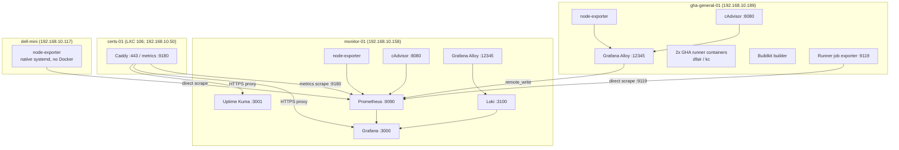

# Monitoring

## Current State

Deployed via Docker on two VMs, plus a native (non-Docker) node-exporter
on `dell-mini`, and Caddy metrics from `certs-01`. The Infrastructure
Overview dashboard has been rebuilt; an updated repository dashboard JSON now
includes a proposed Caddy row, but its import/rendering in live Grafana has not
yet been verified. Related work is tracked in issues
[#3](https://github.com/sethbarrett50/home_lab_docs/issues/3)–[#8](https://github.com/sethbarrett50/home_lab_docs/issues/8),
[#43](https://github.com/sethbarrett50/home_lab_docs/issues/43) for
dell-mini specifically.

## Actual Stack



## Components (as deployed)

| Container | Host | Port | Role |
|---|---|---|---|
| `grafana` | monitor-01 | 3000 | Visualization — Infrastructure Overview dashboard has been rebuilt |
| `prometheus` | monitor-01 | 9090 | Metrics store. **Not** 3001 — that's Kuma (see below, was documented wrong) |
| `uptime-kuma` | monitor-01 | 3001 | **2.5.7**; health checks, CA trust, Telegram DOWN/recovery notification integration via dedicated Mullvad Tinyproxy. See [Telegram proxy](telegram-proxy.md). |
| `loki` | monitor-01 | 3100 | Log aggregation |
| `alloy` | monitor-01 + gha-general-01 | 12345 | Unified telemetry collector — ships node-exporter/cAdvisor data to Prometheus/Loki |
| `cadvisor` | monitor-01 + gha-general-01 | 8080 | Per-container CPU/mem/network metrics |
| `node-exporter` | monitor-01 + gha-general-01 | — | Host-level CPU/mem/disk metrics |
| `node_exporter` (native, not a container) | dell-mini | 9100 | Host-level CPU/mem/disk metrics — scraped directly by Prometheus, no Alloy (dell-mini doesn't run Docker) |
| `dfair-gha-runner-local`, `kc-gha-runner-local` | gha-general-01 | — | The 2 active self-hosted GitHub Actions runners; PL retired 2026-10-22 |
| `gha-runner-job-exporter.service` (systemd/Python) | gha-general-01 | 9119 | Read-only Docker runner log observer; exported metrics for current job names |
| `buildx_buildkit_builder-*` | gha-general-01 | — | Buildkit builder for the runners |

**Fixed (was issue #3):** all scrape targets were still pointed at
pre-migration `192.168.1.x` IPs (proxmox's target was literally still
`192.168.1.197`, its old flat-network address) — a direct side effect of the
VLAN migration earlier this session. Fixed by updating
`/opt/monitoring/prometheus/prometheus.yml` on monitor-01 to the current
`192.168.10.x` addresses and restarting the `prometheus` container. All 7
configured targets (prometheus, monitor-01-node/-containers,
gha-general-01-node/-containers, proxmox-node, dell-mini-node) are now
healthy.

## Caddy and internal HTTPS monitoring (2026-10-20)

Caddy runs on `certs-01` (LXC 106, `192.168.10.50`); full configuration and CA handling are documented in [Internal HTTPS / Caddy](caddy.md). Prometheus runs in Docker on `monitor-01` and reads `/opt/monitoring/prometheus/prometheus.yml` (bind-mounted read-only to `/etc/prometheus/prometheus.yml`). Added one scrape job alongside existing jobs:

```yaml
  - job_name: "caddy"
    scrape_interval: 15s
    metrics_path: /metrics
    static_configs:
      - targets:
          - "192.168.10.50:9180"
```

`promtool check config` passed, the lifecycle reload succeeded, and the target API reported `health: up` with `up{job="caddy"} = 1` and no scrape error. Existing seven targets remain configured; **eight** targets are now configured including Caddy. Caddy exposes upstream health and HTTP metrics. The Prometheus API was rechecked on 2026-10-20: `up{job="caddy"} = 1`, and both `caddy_reverse_proxy_upstreams_healthy` series (`192.168.10.158:3000` and `192.168.10.158:3001`) returned `1`. The values show successful scraping and Caddy-reported upstream state, not verified end-to-end application health.

**Uptime Kuma 2.5.7** runs in Docker Compose at `/opt/monitoring/compose.yml` on `monitor-01`; upgraded from 1.23.17 on 2026-10-25 with existing monitors/history migrated and the persistent named `uptime-kuma-data` volume retained. A checked pre-migration backup is on monitor-01 at `/opt/monitoring/backups/kuma-v1-20261025-130228/uptime-kuma-v1-data.tar.gz` (plus Compose backup). Image is pinned to `louislam/uptime-kuma:2.5.7`, not `latest`.

```yaml
  uptime-kuma:
    image: louislam/uptime-kuma:2.5.7
    dns:
      - 192.168.10.1
    environment:
      NODE_EXTRA_CA_CERTS: /etc/homelab-ca/root.crt
      NOTIFICATION_PROXY: http://192.168.10.171:3128
    volumes:
      - uptime-kuma-data:/app/data
      - /opt/monitoring/certs/homelab-root-ca.crt:/etc/homelab-ca/root.crt:ro
```

Telegram notification provider **Homelab Telegram Alerts** is configured and applied to existing monitors; the user received a successful Telegram Test and actual downtime/recovery testing succeeded once the test monitor's notification was explicitly enabled. This notification proxy is a dedicated HTTPS CONNECT service on CT 107 with Mullvad egress; **monitor probes do not use that proxy simply because `NOTIFICATION_PROXY` is set**. New monitors still need the notification enabled, or the provider's Default Enabled option where available. See [Telegram proxy](telegram-proxy.md). The temporary alert test monitor should be deleted when no longer needed. Prometheus/Grafana alerts remain a separate task.

```bash
# On monitor-01
cd /opt/monitoring
docker compose config -q
docker inspect uptime-kuma --format '{{.State.Status}}'
docker exec uptime-kuma printenv NOTIFICATION_PROXY
# Avoid printing notification configuration or bot tokens.
```

**Not yet instrumented:** `nas` (LXC 105) has no node-exporter and isn't in
the scrape config at all — genuine gap, not a stale-IP issue. Needed before
the Infrastructure Overview dashboard (issue #5) can include it.

## GitHub Actions runner observability (2026-10-22)

The deployed `gha-general-01` runner inventory is **KC + DFAIR only**.
Runner operations, maintenance, systemd safety overrides, and nightly
source-update checks are documented in
[Self-hosted GitHub Actions runners](github-actions-runners.md).
PL was removed from Docker and its dedicated systemd unit was disabled and
removed on 2026-10-22; its old `pl-gha-runner.service` alias is masked.
Removing PL from GitHub's organization-level runner registration is still
not independently verified. The retired runner must not be reintroduced by
backup restore or service automation.

| Runner | Private source repo | Container | Service |
|---|---|---|---|
| KC | [KC-GHA-Runner](https://github.com/Kart-Chaser/KC-GHA-Runner) | `kc-gha-runner-local` | `gha-runner-kc.service` |
| DFAIR | [dfair_runner](https://github.com/DFAIR-LAB-Augusta/dfair_runner) | `dfair-gha-runner-local` | `gha-runner-dfair.service` |

The repos are private. Their *exact* GitHub URLs are excluded from the
unauthenticated lychee link checker in `.lycheeignore`. Other links remain
checked as usual.

A Python HTTP exporter runs as `gha-runner-job-exporter.service` on
`gha-general-01` (`192.168.10.189:9119`) and reads local Docker runner logs.
Its repository copy and systemd unit are under
[`gha_runner_job_exporter.py`](runner-observability/gha_runner_job_exporter.py) and [`gha-runner-job-exporter.service`](runner-observability/gha-runner-job-exporter.service).
It exposes:

- `gha_runner_job_observer_up{runner="kc|dfair|kc_timing"}`: `1` when Docker logs can be read;
  **not** proof GitHub has registered or marked the runner online.
- `gha_runner_job_observer_initialized`: whether a recognizable log marker was seen.
- `gha_runner_current_job{runner="...",job="..."} 1`: inferred unfinished job;
  **absent** when no active job is inferred. Grafana maps absence to
  `None running` when the observer is healthy.

This observer does not use GitHub APIs or expose the originating repository.
It can miss very short jobs or infer stale status if log history rolls over.
A live running-job test against GitHub has **not yet been verified**.
Do not confuse `None running` with a failed exporter: first inspect the
observer metrics and actual `docker logs`.

The Prometheus config on `monitor-01` is bind-mounted from
`/opt/monitoring/prometheus/prometheus.yml` and includes:

```yaml
  - job_name: gha-runner-jobs
    scrape_interval: 15s
    static_configs:
      - targets:
          - '192.168.10.189:9119'
```

On 2026-10-22 `promtool check config` passed, Prometheus was HUP-reloaded,
`curl` from `monitor-01` reached the exporter, and the Prometheus API returned
`gha_runner_job_observer_up=1` for both `kc` and `dfair`. On 2026-10-27 the VM-local exporter additionally returned observer and initialized values of 1 for `kc_timing`; the user reports the Prometheus target was configured, but its new series in the Prometheus API have not yet been independently verified. This verifies the
exporter-to-Prometheus path, not a running-job capture or alert notification.
Limit port 9119 to the monitoring host; it has no authentication and Docker
access held by the exporter service is privileged.

### Diagnostic commands

On `gha-general-01`:

```bash
sudo systemctl status gha-runner-job-exporter.service --no-pager
curl -fsS http://192.168.10.189:9119/metrics
docker logs --tail 30 kc-gha-runner-local
docker logs --tail 30 dfair-gha-runner-local
docker logs --tail 30 kc-timing-runner-local
```

On `monitor-01`:

```bash
sudo docker exec prometheus promtool check config /etc/prometheus/prometheus.yml
curl -fsSG http://localhost:9090/api/v1/query \
  --data-urlencode 'query=gha_runner_job_observer_up' | jq '.data.result'
```

The versioned
[Infrastructure Overview dashboard JSON](dashboards/infra-overview.json)
is a **Grafana 13 Scenes-based JSON**, based on the supplied dashboard and
updated with three runners, current-job stat panels, and corrected single-value
container-health queries. CPU and RAM gauges use actual host capacity;
network gauges show throughput without an assumed link maximum. Because KC
uses host networking, its per-container network metric may be absent.
The user reported importing/updating a Grafana dashboard with the job panels
showing `None running` while KC and DFAIR latest observed jobs had completed.
Import of this *exact version-controlled revision* into live Grafana has
not been independently re-exported and compared. Treat live dashboard
synchronization as a verification step.

Existing Caddy scrape (`:9180`) and other infrastructure panels are retained.
The KC-Timing runner was observed Online / Idle in GitHub on 2026-10-27, and its exporter produces `kc_timing` series. The updated dashboard adds a KC-Timing container-status panel and a current-job stat; import into live Grafana is still required. Outstanding work includes verifying a running workflow appears while active,
reviewing alerts, and deploying authoritative GitHub API runner status if needed.
Related tracking: [#7](https://github.com/sethbarrett50/home_lab_docs/issues/7)
(job-level monitoring), [#8](https://github.com/sethbarrett50/home_lab_docs/issues/8)
(router telemetry).

## Alerting — Telegram deployed; Prometheus/Grafana follow-up

Telegram DOWN/recovery notifications in **Uptime Kuma 2.5.7** were deployed and exercised 2026-10-25 via CT 107. Prometheus/Grafana native alert rules and certificate-expiry alert tuning are separate future work.

### Ideas (not configured)

| Alert | Condition | Severity |
|---|---|---|
| Host down | Node exporter unreachable >2m | Critical |
| High CPU | >90% for >10m | Warning |
| High RAM | >85% | Warning |
| Disk full | >80% on any mount | Warning |
| GHA runner container down | cAdvisor shows container not running | Warning |

No Alertmanager or native notification routing exists yet for Prometheus/Grafana —
they're collection + visualization only, nothing pages/notifies on these
thresholds. Uptime Kuma *does* notify (its own notification channel, separate
from this), but only for its up/down checks.

## Prometheus outage and recovery — 2026-10-22 to 2026-10-25

Prometheus was found `Exited (0)` on 2026-10-25, while Grafana and Uptime Kuma remained healthy. The Prometheus log recorded a graceful SIGTERM at **2026-10-22 20:34:33 UTC**. Host journal and package logs confirmed a user-initiated `apt upgrade -y` on 2026-10-22 at 16:33 EDT installed Docker packages and restarted containerd and Docker at 16:34 EDT. All other monitoring containers recovered, but Prometheus stayed stopped despite its `unless-stopped` restart policy; the exact non-restart mechanism remains unverified. Kuma reported `ECONNREFUSED` to `192.168.10.158:9090`, and Grafana queries failed until recovery.

On `monitor-01`, `sudo docker start prometheus` restored service. `/-/healthy` and `/-/ready` endpoints returned healthy/ready, Prometheus `up` query reported **9/9 targets UP**, and Grafana dashboards displayed data again. Docker and containerd are both enabled at boot; Prometheus retains restart policy `unless-stopped`. Historical samples from the stopped period cannot be regenerated. This incident was not caused by the later WireGuard renaming and relay changes.

For future Docker package upgrades, perform a post-upgrade `sudo docker ps -a`, check each critical container, query `http://127.0.0.1:9090/-/ready` and review Kuma. Do not indiscriminately recreate containers or discard volumes.

## llm-01 NVIDIA GPU telemetry and endpoint monitoring (2026-10-29)

**Live checks completed:** Both Caddy HTTPS LLM endpoints `https://llm.home.arpa/v1/models` and `https://llm-long.home.arpa/v1/models` have green Uptime Kuma monitors. Monitoring uses unauthenticated HTTP with **401 as the accepted response**, establishing reachability/auth enforcement, **not authenticated inference or model correctness**. To allow Kuma from `monitor-01` (192.168.10.158), the `@trusted remote_ip` matcher in **both** Caddy virtual hosts additionally permits this single IP; the Trusted VLAN and HP 192.168.10.147 entries remain. Do not broadly enable VLAN 10. Kuma notification enablement for these particular monitors has not been independently verified.

On `llm-01` (192.168.10.162), the NVIDIA Quadro P4000 has an independent read-only `nvidia-smi-exporter.service` on `192.168.10.162:9835/metrics`, running via a systemd **dynamic user**. The versioned exporter and clean service unit are at [gpu-monitoring/](gpu-monitoring/). Runtime tests returned HTTP 200 with GPU utilization, VRAM used/total bytes, temperature, power, and aggregate compute process count. Two resident llama.cpp processes consumed 7,201 MiB of 8,192 MiB at measurement. This exporter does **not** indicate which process owns how much memory and is not an inference readiness check.

`llm-01` `/etc/nftables.conf` retains the existing Caddy-only restrictions on TCP 8080/8081 and adds, after loopback accept:

```nft
meta nfproto ipv6 tcp dport 9835 drop
ip saddr != 192.168.10.158 tcp dport 9835 drop
```

This allows remote IPv4 scrapes from `monitor-01` only; input policy remains ACCEPT for other ports. The firewall was syntax-checked and reloaded, and `monitor-01` successfully scraped `/metrics` afterward. Tests from disallowed remote sources were not independently recorded.

Prometheus is the `prometheus` Docker container on `monitor-01`. The actual bind-mounted configuration is **`/opt/monitoring/prometheus/prometheus.yml`** (container path `/etc/prometheus/prometheus.yml`). An additional job was deployed:

```yaml
  - job_name: "llm-01-gpu"
    scrape_interval: 15s
    metrics_path: /metrics
    static_configs:
      - targets: ["192.168.10.162:9835"]
        labels:
          host: "llm-01"
          role: "gpu-inference"
```

`curl -X POST http://127.0.0.1:9090/-/reload` succeeded, target health became **up** with no scrape error (~29.5 ms), and PromQL returned **7.03 GiB** used VRAM. `docker exec prometheus promtool check config /etc/prometheus/prometheus.yml` returned SUCCESS. This makes **10 active targets** at verification. The dashboard's new GPU row is tracked in [infra-overview.json](dashboards/infra-overview.json); see [dashboard import and validation](dashboards/README.md) before deploying it.

```bash
# On monitor-01
curl -fsSG --data-urlencode 'query=up{job="llm-01-gpu"}' \
  http://127.0.0.1:9090/api/v1/query
curl -fsS http://192.168.10.162:9835/metrics
docker exec prometheus promtool check config /etc/prometheus/prometheus.yml
```

**Known limits:** No GPU Prometheus alert rules yet. Qwen3 8B and Qwen3.5 2B remain concurrently resident; adaptive model swapping and Codex-to-local fallback are not demonstrated by these monitoring checks. Grafana UI import/rendering of the newly generated JSON is pending live confirmation.
