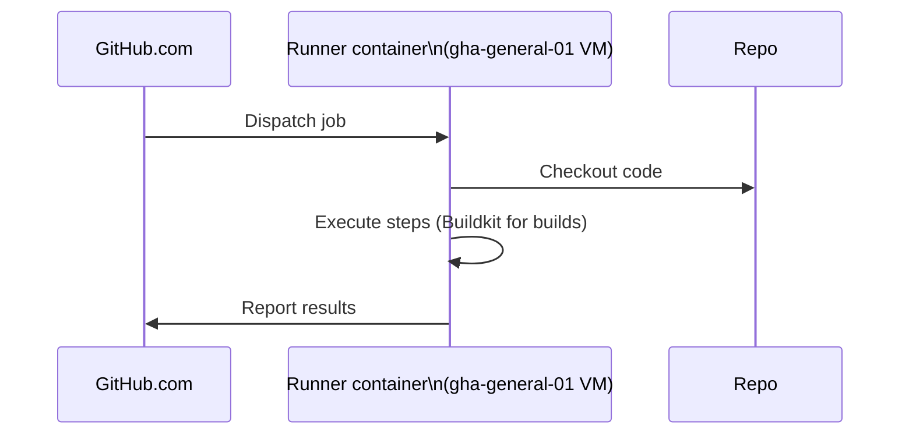

# Proxmox

## Host

**Dell Precision 3620** running Proxmox VE.

| Property | Value |
|---|---|
| IP | 192.168.10.10 (static) |
| Web UI | `https://pve.home.arpa:8006/` (CA-trusted hostname); IP-based access also available on port 8006 but certificate name does not match IP |
| VLAN | 10 — Lab |
| Proxmox | **VE 9.2.21 (kernel 6.17.13-21-pve)** — upgraded 2026-10-20 |
| BIOS | 2.8.1 |
| CPU | Intel Core i7-6700K (Skylake) — 4C/8T, 4.0–4.2 GHz |
| RAM | 32 GB — 4× 8 GB DDR4-2400 (all slots full), running at 2133 MT/s (the i7-6700K's rated max). ~18 GiB used at time of original inspection. 8 GiB swap |
| Boot/VM disk | Toshiba XG5 512 GB NVMe (`KXG50ZNV512G`) — holds `local` + `local-lvm` |
| HDDs | 2× 1 TB SATA 7200rpm — Seagate `ST1000DM003` (`sda`), Seagate `ST31000528AS` (`sdb`) — **`sdb` SMART FAILED 2026-10-13** (Reallocated_Sector_Ct 4015), unused, to be pulled/retired ([#57](https://github.com/sethbarrett50/home_lab_docs/issues/57)) |

Hardware specs collected 2026-10-08 via `dmidecode`, `lscpu`, and `lsblk`. Proxmox version and running kernel verified following the 2026-10-20 upgrade and reboot.

## Current Setup

Actual running VMs/LXCs (see [devices/README.md](../devices/README.md) for IPs/hostnames and [Service Status](README.md#service-status) for the full services overview):

| VM/LXC | ID | Role |
|---|---|---|
| `gha-general-01` | VM 101 | 3x GitHub Actions runner containers (`dfair`/`pl`/`kc`), Buildkit, Grafana Alloy, cAdvisor, node-exporter |
| `monitor-01` | VM 102 | Grafana, Prometheus, Loki, Uptime Kuma, Alloy, cAdvisor, node-exporter — see [monitoring.md](monitoring.md) |
| `nas` | LXC 105 | File storage — software TBD, see [nas.md](nas.md). Data is mp0 `/mnt/pve/hdd-1tb/nas-share` -> `/mnt/nas-share` (`sda1`); rootfs on `local-lvm` |
| `certs-01` | LXC 106 | Debian 13, unprivileged; Caddy 2.6.2, internal CA and HTTPS reverse proxy; `192.168.10.50`, see [caddy.md](caddy.md) |

### Guest Autostart

The following guests were verified running after the 2026-10-20 Proxmox reboot:

| ID | Guest | Autostart |
|---|---|---|
| 101 | `gha-general-01` | Enabled |
| 102 | `monitor-01` | Enabled |
| 105 | `nas` | Enabled |
| 106 | `certs-01` | Enabled during upgrade maintenance |

CT 106 initially lacked `onboot: 1`. Autostart was configured before the reboot, and the container successfully returned to the running state.

Verify guest startup configuration:

```bash
qm config 101 | grep -E '^(name|onboot|startup):'
qm config 102 | grep -E '^(name|onboot|startup):'

pct config 105 | grep -E '^(hostname|onboot|startup):'
pct config 106 | grep -E '^(hostname|onboot|startup):'
```

All four guests depend on this Proxmox host; restarting it temporarily interrupts the monitoring stack, GitHub Actions runners, NAS, and HTTPS reverse proxy.

### Future ideas (not started, no concrete plan)

Debian/macOS/Windows general-purpose VMs and an OPNsense/pfSense firewall VM were floated before any of the above was actually deployed — none have specs, a timeline, or active work behind them. Listed in [Service Status](README.md#service-status) as low-priority "Planned" items; revisit here with real specs only once one is actually prioritized.

## GitHub Actions Runners

Self-hosted, 3 runners (`dfair`/`pl`/`kc`) as Docker containers inside the `gha-general-01` VM — not directly on the Proxmox host. Each dispatches CI jobs from its respective repo:



## Storage Layout

From `pvesm status` (2026-10-13):

| Storage | Type | Size | Used | Use |
|---|---|---|---|---|
| `local` | dir | ~94 GiB | ~5% | ISOs, templates, backups (on the NVMe root LV) |
| `local-lvm` | LVM-thin | ~349 GiB | ~25% | VM/LXC disks (NVMe) |
| `hdd-1tb` | dir | ~916 GiB | ~45% | Bulk storage on `sda1` (`/mnt/pve/hdd-1tb`, `is_mountpoint 1`) |

The `hdd-tmp-1tb` storage was removed 2026-10-13. It had never been backed by `sdb1` (formatted but not attached, no `is_mountpoint 1`), so it was a plain directory on the NVMe root fs; `sdb` has since failed SMART (see [Host](#host)).

No NAS-backed (NFS/CIFS) storage yet — see [nas.md](nas.md).

## Backups

Job `nightly-all` (vzdump), created 2026-10-13 for #56:

| Setting | Value |
|---|---|
| Schedule | 02:30 daily (host local time) |
| Scope | All guests |
| Mode | `snapshot` |
| Compression | `zstd` |
| Storage | `hdd-1tb` |
| Retention | `keep-daily=3`, `keep-weekly=2` |

First manual run (2026-10-13) sizes: VM 101 ~24 GB, VM 102 ~5 GB, CT 105 ~266 MB.

CT 106 (`certs-01`) was deployed and manually backed up with `vzdump` on 2026-10-20; the backup archive is approximately 224 MB. Its ongoing coverage under the all-guests `nightly-all` job should be confirmed from the next completed job. **Treat CT 106 backups as sensitive** because they include CA private-key material.

- CT 105's `mp0` NAS share (`/mnt/pve/hdd-1tb/nas-share`) is not in the backup.
- Backups share `sda` with the NAS data, so a failure of `sda` loses both; there is no offsite or second-disk copy.

## Internal HTTPS Certificate

The Proxmox UI is accessed directly at `https://pve.home.arpa:8006/` (DNS resolves to `192.168.10.10`); **it is not proxied through Caddy**.

On 2026-10-20, a Proxmox-host-generated RSA 3072-bit key and CSR were signed using the Caddy local root CA in `certs-01`. The certificate contains the `pve.home.arpa` SAN and expires **2027-10-20**.

The Proxmox host installed the key and certificate using `pvenode cert set ... --restart 1`; the public CA must also be trusted on clients. GET requests from `monitor-01` successfully verified the certificate and returned HTTP 200.

The certificate **does not automatically renew** with Caddy's own leaf certificates. Arrange renewal well before October 2027, protect both the Proxmox key and Caddy CA key, and document a restricted signing/rotation process.

Following the 2026-10-20 Proxmox upgrade, the HTTPS interface was verified working with the existing trusted certificate.

See [Internal HTTPS / Caddy](caddy.md#internal-ca-and-client-trust).

## Maintenance and Updates

### APT Repositories

The host uses Debian 13 (Trixie) and the official Proxmox VE no-subscription repository.

| Repository | Configuration | Status |
|---|---|---|
| Debian Trixie | `deb.debian.org` | Enabled |
| Debian Security | `security.debian.org` | Enabled |
| Proxmox No-Subscription | `download.proxmox.com/debian/pve` | Enabled |
| Proxmox Enterprise | `enterprise.proxmox.com/debian/pve` | Disabled |
| Ceph Enterprise | `enterprise.proxmox.com/debian/ceph-squid` | Disabled |

The no-subscription repository is configured in `/etc/apt/sources.list.d/proxmox.sources`:

```text
URIs: http://download.proxmox.com/debian/pve
Suites: trixie
Components: pve-no-subscription
```

The enterprise repositories remain defined but disabled using `Enabled: false`.

The no-subscription channel provides updates without a paid subscription, but does not receive the same level of enterprise validation.

**Note:** The Proxmox login popup stating that no valid subscription is installed is expected. It does not prevent updates or indicate a repository problem.

To inspect repository configuration:

```bash
grep -RHnE '^(URIs:|Suites:|Components:|Enabled:|deb )' \
  /etc/apt/sources.list \
  /etc/apt/sources.list.d/ 2>/dev/null
```

### Upgrade History

#### 2026-10-20 — Proxmox VE 9.1.1 → 9.2.21

The host was upgraded after correcting the APT repositories.

Completed and verified:

- Disabled the PVE and Ceph Enterprise repositories.
- Enabled the Proxmox no-subscription repository.
- Installed updated Proxmox packages and kernels.
- Verified `dpkg --audit` reported no incomplete or broken package configurations.
- Successfully rebooted into kernel `6.17.13-21-pve`.
- Verified Proxmox Manager reported version `9.2.21`.
- Confirmed `pveproxy`, `pvedaemon`, and `pvestatd` were active.
- Confirmed all four VMs/LXCs were running.
- Confirmed internal HTTPS interfaces were accessible with trusted certificates.
- Resolved the failed OpenIPMI service.

### Kernel Selection

The upgrade installed multiple kernel versions:

| Kernel | Status at upgrade |
|---|---|
| `6.17.2-1-pve` | Previously running |
| `6.17.13-21-pve` | Selected and verified after reboot |
| `7.0.14-25-pve` | Installed but not selected for the verified reboot |

Kernel `6.17.13-21-pve` was selected for the next boot using:

```bash
proxmox-boot-tool kernel pin 6.17.13-21-pve --next-boot
```

The host successfully booted into that kernel.

**Important:** This was a one-time pin. It does not permanently prevent a newer installed kernel from being selected on subsequent boots.

Check kernel status before future maintenance reboots:

```bash
uname -r
proxmox-boot-tool kernel list
grep '^GRUB_DEFAULT=' /etc/default/grub
```

Review kernel selection when applying future updates rather than assuming the host will remain on 6.17.

### OpenIPMI

After the upgrade, `openipmi.service` failed during startup:

```text
Starting ipmi drivers ipmi failed!
```

Investigation found:

- No `/dev/ipmi*` device nodes.
- `ipmi_devintf` and `ipmi_msghandler` kernel modules were loaded.
- No working IPMI device interface was identified.
- The Dell Precision 3620 does not rely on this service for the current Proxmox deployment.

The unused startup service was disabled:

```bash
systemctl disable --now openipmi.service
systemctl reset-failed openipmi.service
```

Verification:

```bash
systemctl is-enabled openipmi.service
systemctl --failed
```

Results:

- `openipmi.service`: `disabled`
- Failed systemd units: `0`

The service uses a legacy SysV initialization script, so messages referring to `systemd-sysv-install` are expected.

### Routine Maintenance

On the **Proxmox host (`pve`, 192.168.10.10)**:

```bash
# Verify versions
pveversion
uname -r

# Refresh repositories
apt update

# Review pending upgrades
apt list --upgradable
apt -s full-upgrade

# Apply upgrades after reviewing proposed changes
apt full-upgrade

# Verify package and service health
dpkg --audit
systemctl --failed
systemctl is-active pveproxy pvedaemon pvestatd

# Verify guests
qm list
pct list
```

Inspect proposed package removals before applying upgrades. Do not proceed if APT unexpectedly proposes removing `proxmox-ve` or essential Proxmox components.

Kernel updates may require a reboot. Schedule maintenance accordingly because all VMs and LXCs run on this single host.

After reboot, verify that Proxmox services, guests, and the internal HTTPS interfaces are working as expected.

## Notifications

- Current target: builtin `mail-to-root` (sendmail) with `default-matcher` routing all notifications to it.
- It cannot deliver from this network (SMTP does not work), so failures of the backup job will not alert anyone.
- Email was declined 2026-10-13; a webhook is the follow-up once Mullvad gives working egress, tracked in [#12](https://github.com/sethbarrett50/home_lab_docs/issues/12).

## TODO

- [x] Document actual CPU/RAM specs of the 3620
- [x] Configure Proxmox backup schedule — `nightly-all` on `hdd-1tb`, 02:30 daily (see [Backups](#backups))
- [x] Configure Proxmox no-subscription repository and disable enterprise repositories — 2026-10-20
- [x] Upgrade Proxmox VE to 9.2.21 and verify reboot — 2026-10-20
- [x] Verify VM/LXC startup after Proxmox upgrade
- [x] Resolve unused OpenIPMI service failure
- [ ] Confirm CT 106 is included in a completed nightly backup
- [ ] Review kernel selection before future reboots
- [ ] Add NAS storage as Proxmox datastore once HDDs arrive
- [x] Resolve `sdb1` / `hdd-tmp-1tb` — storage removed 2026-10-13; `sdb` is failing, not reattached
- [ ] Physically retire `sdb` (SMART FAILED) — [#57](https://github.com/sethbarrett50/home_lab_docs/issues/57)
- [ ] Set up Proxmox notifications (email or webhook) — blocked on [#12](https://github.com/sethbarrett50/home_lab_docs/issues/12)
