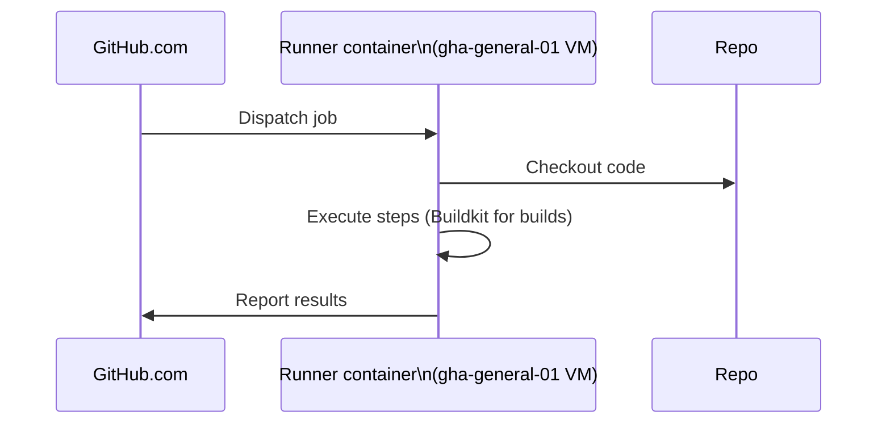

# Proxmox

## Host

**Dell Precision 3620** running Proxmox VE.

| Property | Value |
|---|---|
| IP | 192.168.10.10 (static) |
| Web UI | https://192.168.10.10:8006 |
| VLAN | 10 — Lab |
| Proxmox | VE 9.1.1 (kernel 6.17.2-1-pve) |
| BIOS | 2.8.1 |
| CPU | Intel Core i7-6700K (Skylake) — 4C/8T, 4.0–4.2 GHz |
| RAM | 32 GB — 4× 8 GB DDR4-2400 (all slots full), running at 2133 MT/s (the i7-6700K's rated max). ~18 GiB used at time of writing. 8 GiB swap |
| Boot/VM disk | Toshiba XG5 512 GB NVMe (`KXG50ZNV512G`) — holds `local` + `local-lvm` |
| HDDs | 2× 1 TB SATA 7200rpm — Seagate `ST1000DM003` (`sda`), Seagate `ST31000528AS` (`sdb`) — **`sdb` SMART FAILED 2026-10-13** (Reallocated_Sector_Ct 4015), unused, to be pulled/retired ([#57](https://github.com/sethbarrett50/home_lab_docs/issues/57)) |

Specs collected 2026-10-08 via `dmidecode`, `lscpu`, `lsblk`, `pveversion`.

## Current Setup

Actual running VMs/LXCs (see [devices/README.md](../devices/README.md) for
IPs/hostnames and [Service Status](README.md#service-status) for the full
services overview):

| VM/LXC | ID | Role |
|---|---|---|
| `gha-general-01` | VM 101 | 3x GitHub Actions runner containers (`dfair`/`pl`/`kc`), Buildkit, Grafana Alloy, cAdvisor, node-exporter |
| `monitor-01` | VM 102 | Grafana, Prometheus, Loki, Uptime Kuma, Alloy, cAdvisor, node-exporter — see [monitoring.md](monitoring.md) |
| `nas` | LXC 105 | File storage — software TBD, see [nas.md](nas.md). Data is mp0 `/mnt/pve/hdd-1tb/nas-share` -> `/mnt/nas-share` (`sda1`); rootfs on `local-lvm` |

### Future ideas (not started, no concrete plan)

Debian/macOS/Windows general-purpose VMs and an OPNsense/pfSense firewall
VM were floated before any of the above was actually deployed — none have
specs, a timeline, or active work behind them. Listed in
[Service Status](README.md#service-status) as low-priority "Planned" items;
revisit here with real specs only once one is actually prioritized.

## GitHub Actions Runners

Self-hosted, 3 runners (`dfair`/`pl`/`kc`) as Docker containers inside the
`gha-general-01` VM — not directly on the Proxmox host. Each dispatches CI
jobs from its respective repo:

## Storage Layout

From `pvesm status` (2026-10-13):

| Storage | Type | Size | Used | Use |
|---|---|---|---|---|
| `local` | dir | ~94 GiB | ~5% | ISOs, templates, backups (on the NVMe root LV) |
| `local-lvm` | LVM-thin | ~349 GiB | ~25% | VM/LXC disks (NVMe) |
| `hdd-1tb` | dir | ~916 GiB | ~45% | Bulk storage on `sda1` (`/mnt/pve/hdd-1tb`, `is_mountpoint 1`) |

The `hdd-tmp-1tb` storage was removed 2026-10-13. It had never been backed by
`sdb1` (formatted but not attached, no `is_mountpoint 1`), so it was a plain
directory on the NVMe root fs; `sdb` has since failed SMART (see [Host](#host)).

No NAS-backed (NFS/CIFS) storage yet — see [nas.md](nas.md).

## Backups

Job `nightly-all` (vzdump), created 2026-10-13 for #56:

| Setting | Value |
|---|---|
| Schedule | 02:30 daily (host local time) |
| Scope | All guests |
| Mode | `snapshot` |
| Compression | `zstd` |
| Storage | `hdd-1tb` |
| Retention | `keep-daily=3`, `keep-weekly=2` |

First manual run (2026-10-13) sizes: VM 101 ~24 GB, VM 102 ~5 GB, CT 105 ~266 MB.

- CT 105's `mp0` NAS share (`/mnt/pve/hdd-1tb/nas-share`) is not in the backup
- Backups share `sda` with the NAS data, so a failure of `sda` loses both; there is no offsite or second-disk copy

## Notifications

- Current target: builtin `mail-to-root` (sendmail) with `default-matcher` routing all notifications to it
- It cannot deliver from this network (SMTP does not work), so failures of the backup job will not alert anyone
- Email was declined 2026-10-13; a webhook is the follow-up once Mullvad gives working egress, tracked in [#12](https://github.com/sethbarrett50/home_lab_docs/issues/12)

## TODO

- [x] Document actual CPU/RAM specs of the 3620
- [x] Configure Proxmox backup schedule — `nightly-all` on `hdd-1tb`, 02:30 daily (see [Backups](#backups))
- [ ] Add NAS storage as Proxmox datastore once HDDs arrive
- [x] Resolve `sdb1` / `hdd-tmp-1tb` — storage removed 2026-10-13; `sdb` is failing, not reattached
- [ ] Physically retire `sdb` (SMART FAILED) — [#57](https://github.com/sethbarrett50/home_lab_docs/issues/57)
- [ ] Set up Proxmox notifications (email or webhook) — blocked on [#12](https://github.com/sethbarrett50/home_lab_docs/issues/12)
