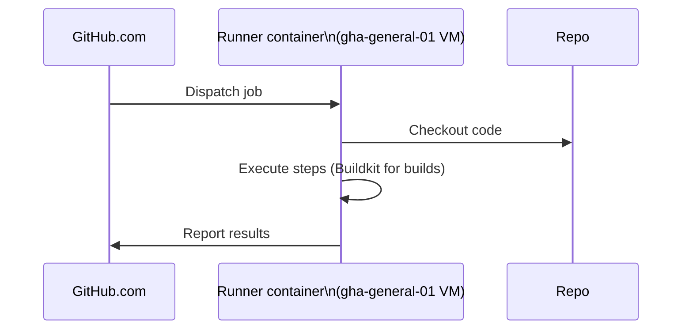

# Proxmox

## Host

**Dell Precision 3620** running Proxmox VE.

| Property | Value |
|---|---|
| IP | 192.168.10.10 (static) |
| Web UI | `https://pve.home.arpa:8006/` (CA-trusted hostname); IP-based access also available on port 8006 but certificate name does not match IP |
| VLAN | 10 — Lab |
| Proxmox | VE 9.1.1 (kernel 6.17.2-1-pve) |
| BIOS | 2.8.1 |
| CPU | Intel Core i7-6700K (Skylake) — 4C/8T, 4.0–4.2 GHz |
| RAM | 32 GB — 4× 8 GB DDR4-2400 (all slots full), running at 2133 MT/s (the i7-6700K's rated max). ~18 GiB used at time of writing. 8 GiB swap |
| Boot/VM disk | Toshiba XG5 512 GB NVMe (`KXG50ZNV512G`) — holds `local` + `local-lvm` |
| Active SATA drives | Seagate ST1000DM003 1 TB HDD (serial `S1D1KDE1`); Silicon Power `SPCC Solid State Disk` ~1 TB SSD (serial `TCSQA259JX05709`); WD Blue WD5000LPVX 500 GB 2.5-inch HDD (serial `WD-WX11E33U6104`) |
| Retired disk | Seagate ST31000528AS 1 TB (serial `6VPA03CV`), failed SMART; physically removed 2026-10-21 ([#57](https://github.com/sethbarrett50/home_lab_docs/issues/57)) |
| Optical-bay drive | Additional 3.5-inch HDD physically fitted in a quick-swap/optical bay; not enumerated by SATA/Linux on 2026-10-21, so not in service |

Core host specs collected 2026-10-08 via `dmidecode`, `lscpu`, `lsblk`, `pveversion`; disk inventory updated and validated 2026-10-21.

## Current Setup

Actual running VMs/LXCs (see [devices/README.md](../devices/README.md) for
IPs/hostnames and [Service Status](README.md#service-status) for the full
services overview):

| VM/LXC | ID | Role |
|---|---|---|
| `gha-general-01` | VM 101 | 2x GitHub Actions runner containers (`dfair`/`kc`); PL retired 2026-10-22, Buildkit, Grafana Alloy, cAdvisor, node-exporter |
| `monitor-01` | VM 102 | Grafana, Prometheus, Loki, Uptime Kuma, Alloy, cAdvisor, node-exporter — see [monitoring.md](monitoring.md) |
| `nas` | LXC 105 | File storage — software TBD, see [nas.md](nas.md). Data is mp0 `/mnt/pve/hdd-1tb/nas-share` -> `/mnt/nas-share` (`sda1`); rootfs on `local-lvm` |
| `certs-01` | LXC 106 | Debian 13, unprivileged; Caddy 2.6.2, internal CA and HTTPS reverse proxy; `192.168.10.50`, see [caddy.md](caddy.md) |

### Future ideas (not started, no concrete plan)

Debian/macOS/Windows general-purpose VMs and an OPNsense/pfSense firewall
VM were floated before any of the above was actually deployed — none have
specs, a timeline, or active work behind them. Listed in
[Service Status](README.md#service-status) as low-priority "Planned" items;
revisit here with real specs only once one is actually prioritized.

## GitHub Actions Runners

Self-hosted, **2 active runners** (`dfair` and `kc`) as Docker containers inside the
`gha-general-01` VM — not directly on the Proxmox host. They register with their
respective GitHub organizations and can execute jobs from authorized repositories
within those organizations.

| Runner | Private runner image/source repository | Container | Systemd service |
|---|---|---|---|
| KC | [Kart-Chaser/KC-GHA-Runner](https://github.com/Kart-Chaser/KC-GHA-Runner) | `kc-gha-runner-local` | `gha-runner-kc.service` |
| DFAIR | [DFAIR-LAB-Augusta/dfair_runner](https://github.com/DFAIR-LAB-Augusta/dfair_runner) | `dfair-gha-runner-local` | `gha-runner-dfair.service` |

These two GitHub repositories are **private**. `.lycheeignore` excludes only
these exact URLs from unauthenticated CI link checking; it does not exempt
other links.

**PL retirement (2026-10-22):** `gha-runner-pl.service` disabled and its
unit file removed; `pl-gha-runner-local` stopped and deleted, and
`pl-gha-runner:dev` deleted. The old alias `pl-gha-runner.service` remains
masked. Removal from the PrivateLingua GitHub organization runner registry
was advised but **not independently verified**. Do not redeploy PL as part
of routine VM maintenance.

Runner container/active job monitoring is documented in
[Monitoring](monitoring.md#github-actions-runner-observability-2026-10-22).



## Storage Layout

Verified via `lsblk`, `pvs`, `vgs`, `lvs`, `findmnt`, `pvesm status` and
`/etc/pve/storage.cfg` on **2026-10-21**. Capacities are approximate usable
values reported by Proxmox; utilization is a point-in-time measurement.

| Storage | Type | Capacity | Used | Physical backing and purpose |
|---|---|---:|---:|---|
| `local` | dir | ~94 GiB | 7.81% | Toshiba XG5 NVMe root filesystem; ISO/template/import/backup files |
| `local-lvm` | LVM-thin | ~349 GiB | 26.34% | Toshiba XG5 NVMe, VG `pve`, pool `data`; existing VM/LXC disks |
| `hdd-1tb` | dir (ext4) | ~916 GiB | 58.67% | Seagate ST1000DM003, serial `S1D1KDE1`, partition mounted at `/mnt/pve/hdd-1tb`; bulk NAS share and nightly backups |
| `ssd-1tb` | LVM-thin | ~906 GiB | 0% | Silicon Power SSD, serial `TCSQA259JX05709`, VG `vg_ssd_1tb`, thin pool `data`; VM/LXC disks only |
| `hdd-500gb` | dir (ext4) | ~457 GiB | ~0% | WD Blue WD5000LPVX, serial `WD-WX11E33U6104`, partition mounted at `/mnt/pve/hdd-500gb`; backups/ISOs/templates/snippets permitted, currently empty |

### Drive installation and validation (2026-10-21)

- Physically removed the failing Seagate ST31000528AS, serial `6VPA03CV`.
  Keep the active ST1000DM003 (`S1D1KDE1`) distinct: it still holds
  `/mnt/pve/hdd-1tb` and NAS data.
- Installed a 2.5-inch SSD and WD Blue laptop HDD in a dual-drive metal
  3.5-inch bracket, using separate SATA data cables and a shared SATA power
  splitter. Both negotiate SATA 6 Gb/s; boot logs did not show a SATA reset
  or I/O error during validation.
- Both new drives passed **extended SMART self-tests** with no errors.
  The Silicon Power SSD reported zero reallocated sectors; the WD reported
  zero reallocated, pending and uncorrectable sectors (676 power-on hours
  at self-test completion). This is a point-in-time health check, not
  ongoing monitoring.
- The SSD has a separate LVM volume group (`vg_ssd_1tb`), with a ~905.95 GiB
  thin pool and ~47.7 GiB free VG space. LVM warned about pool zeroing and
  its 512 KiB chunk size during creation; the pool is operational and empty.
  Monitor pool **data and metadata** usage before heavy provisioning.
- The WD has a GPT partition table and ext4 filesystem with label
  `wd-500gb`, UUID `9d5ba0ed-81e2-414a-99cc-f37bc0fcd387`. It is mounted
  using `/etc/fstab` with `defaults,nofail` and registered with
  `is_mountpoint 1` to avoid accidental writes to the underlying root
  directory if the HDD is unavailable.
- The extra drive placed in the optical quick-swap bay was **not detected**;
  it is not counted as available storage. Investigation deferred.

The prior `hdd-tmp-1tb` storage entry was removed on 2026-10-13; it had
never actually mounted the failed drive. No NAS-backed NFS/CIFS Proxmox
storage is configured yet (see [nas.md](nas.md)).

### Storage configuration verification

```bash
pvesm status
cat /etc/pve/storage.cfg
lsblk -o NAME,MODEL,SERIAL,SIZE,FSTYPE,MOUNTPOINTS
pvs && vgs && lvs -a -o lv_name,vg_name,lv_size,segtype,data_percent,metadata_percent
findmnt /mnt/pve/hdd-1tb
findmnt /mnt/pve/hdd-500gb
```

Do not rely on `/dev/sdX` device letters after hardware changes. Use the
serial numbers and `/dev/disk/by-id/` links when identifying physical disks.

## Backups

Job `nightly-all` (`vzdump`), originally created 2026-10-13 for #56,
confirmed via `pvesh get /cluster/backup` on **2026-10-21**:

| Setting | Value |
|---|---|
| Schedule | 02:30 daily (host local time) |
| Scope | All guests (`all=1`) |
| Mode | `snapshot` |
| Compression | `zstd` |
| Destination | `hdd-1tb` — **unchanged** after installing the WD HDD |
| Retention | `keep-daily=3`, `keep-weekly=2` |
| Notifications | Proxmox notification system; delivery not confirmed (see [Notifications](#notifications)) |

The `hdd-1tb` backup directory held approximately **150 GiB** on
2026-10-21. The archive inventory includes recent backups of all four
running guests: VM 101 (GitHub Actions runners), VM 102 (monitoring),
CT 105 (NAS), and CT 106 (Caddy/internal CA). The October 21 archives were
about 28.1 GB, 5.8 GB, 279 MB, and 234 MB respectively (decimal sizes),
though actual backup sizes vary by day. An older June 2 VM 101 archive was
also present; do not assume pruning removed every older archive.

**Outstanding backup limitations:**

- CT 105's bind-mounted `mp0` NAS data (`/mnt/pve/hdd-1tb/nas-share`) is
  outside its container root filesystem and **not** included in the normal
  LXC backup.
- Scheduled backups are still on the same **Seagate physical drive** as the
  NAS data. A failure of that disk could lose both source data and backups.
- The new `hdd-500gb` is registered as a backup-capable destination, but
  no job has been moved to it and no archive migration has occurred. Its
  available space (~434 GiB after formatting/mounting) appears adequate for
  multiple current compressed guest backup sets, but retention and other
  data must be reviewed before changing the schedule.
- CT 106 backup archives may contain **private CA key material** and need
  restricted access and independent, tested recovery procedures.
- No verified off-host/offsite backup or test restore is documented.

Review backup destination, retention, restore testing, and off-host copies
as a separate follow-up. Do not consider a second drive inside the same
chassis a full disaster-recovery strategy.

## Internal HTTPS certificate

The Proxmox UI is accessed directly at `https://pve.home.arpa:8006/` (DNS resolves to `192.168.10.10`); **it is not proxied through Caddy**. On 2026-10-20, a Proxmox-host-generated RSA 3072-bit key and CSR were signed using the Caddy local root CA in `certs-01`. The certificate contains the `pve.home.arpa` SAN and expires **2027-10-20**. The Proxmox host installed the key and certificate using `pvenode cert set ... --restart 1`; the public CA must also be trusted on clients. GET requests from `monitor-01` successfully verified the certificate and returned HTTP 200.

The certificate **does not automatically renew** with Caddy's own leaf certificates. Arrange renewal well before October 2027, protect both the Proxmox key and Caddy CA key, and document a restricted signing/rotation process. See [Internal HTTPS / Caddy](caddy.md#internal-ca-and-client-trust).

## Notifications

- Current target: builtin `mail-to-root` (sendmail) with `default-matcher` routing all notifications to it
- It cannot deliver from this network (SMTP does not work), so failures of the backup job will not alert anyone
- Email was declined 2026-10-13; a webhook is the follow-up once Mullvad gives working egress, tracked in [#12](https://github.com/sethbarrett50/home_lab_docs/issues/12)

## TODO

- [x] Document actual CPU/RAM specs of the 3620
- [x] Configure Proxmox backup schedule — `nightly-all` on `hdd-1tb`, 02:30 daily (see [Backups](#backups))
- [ ] Add NAS storage as Proxmox datastore once HDDs arrive
- [x] Resolve `hdd-tmp-1tb` — stale storage removed 2026-10-13
- [x] Remove failed Seagate ST31000528AS (`6VPA03CV`) — physically retired 2026-10-21, [#57](https://github.com/sethbarrett50/home_lab_docs/issues/57)
- [x] Add `ssd-1tb` LVM-thin pool on Silicon Power SSD — 2026-10-21
- [x] Add `hdd-500gb` ext4 directory storage on WD Blue — 2026-10-21
- [ ] Review backup placement, retention, off-host copies and restore testing
- [ ] Add scheduled SMART health checks/alerts (separate issue)
- [ ] Investigate undetected optical-bay drive (deferred)
- [ ] Set up Proxmox notifications (email or webhook) — blocked on [#12](https://github.com/sethbarrett50/home_lab_docs/issues/12)
