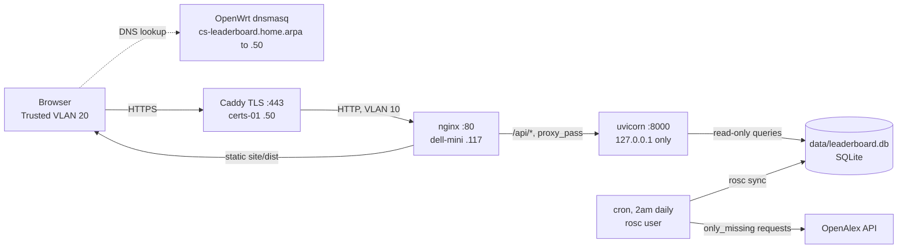

# research-output-scraper

## Status: Done — running internally over HTTPS (validated 2026-10-21)

A leaderboard of US-based CS researchers ranked by publication count,
sourced from the [OpenAlex](https://openalex.org/) API. Pilot scope covers
five institutions (University of Georgia, Georgia Tech, MIT, Carnegie
Mellon, Augusta University). Private repo:
[sethbarrett50/research-output-scraper](https://github.com/sethbarrett50/research-output-scraper).

Unlike everything else in [Services](README.md), this doesn't run on the
Proxmox node — it's deployed directly on `dell-mini` (see
[devices/README.md](../devices/README.md)), per that repo's own
`docs/deploy.md`.

## Architecture



- **Caddy** on `certs-01` terminates internal HTTPS for `cs-leaderboard.home.arpa` using the existing trusted Caddy CA and forwards to `dell-mini:80`; DNS points to Caddy, not to `dell-mini`.
- **nginx** serves the built static site (`site/dist/`, a Vite multi-page
  build) directly and reverse-proxies `/api/` to uvicorn. It's the only
  thing actually reachable from outside `dell-mini` — uvicorn binds
  `127.0.0.1` only. A trusted-proxy nginx real-IP configuration now restores
  the client IP from Caddy; the application uses `X-Real-IP` for rate limiting.
  Direct access to nginx port 80 remains possible under the documented
  firewall rules, so header spoofing through direct HTTP is an outstanding
  security limitation, not a resolved hardening item.
- **systemd** (`research-output-scraper-api.service`) runs the FastAPI
  backend. No container — single-process deploy to a single box, per that
  repo's `docs/deploy.md` "Why this shape" section.
- **cron**, under a dedicated unprivileged `rosc` system user, runs
  `rosc sync` nightly at 2am. This only refreshes students already in the
  database (`only_missing`-scoped, so it doesn't re-burn OpenAlex budget);
  newly discovered candidate authors stay `pending` until a human runs
  `rosc review` by hand — unattended cron can't do that step.

## Network

| Property | Value |
|---|---|
| Host | `dell-mini` (192.168.10.117), VLAN 10 (Lab) |
| Client URL | `https://cs-leaderboard.home.arpa/` (internal-only) |
| DNS / HTTPS | `cs-leaderboard.home.arpa` → `192.168.10.50:443` (Caddy / `certs-01`) |
| Backend | Caddy → `192.168.10.117:80` (nginx over VLAN 10) |
| Legacy direct HTTP access | `lan`, `trusted` → `dell-mini:80` remains documented (see [devices/README.md § Cross-VLAN Firewall Rules](../devices/README.md#cross-vlan-firewall-rules-lab-access-from-mgmttrusted)) |
| API internal port | 8000, `127.0.0.1` only — never exposed |

The `lan`/`trusted` → `dell-mini:80` firewall rules didn't exist when this
was first deployed — the site 404'd from outside `dell-mini` until that gap
was found and two `uci` rules were added on the Flint 2 (`lan`→`lab` and
`trusted`→`lab`, both dest `192.168.10.117:80`). See the firewall rule
table linked above for the documented set. Trusted → `certs-01:443` was confirmed by a successful HTTPS request from VLAN 20; the full live firewall ruleset was not audited.

## Trusted-proxy and API behavior (2026-10-21)

`/etc/nginx/conf.d/trusted-proxy.conf` was installed on `dell-mini` with:

```nginx
set_real_ip_from 192.168.10.50;
real_ip_header X-Forwarded-For;
real_ip_recursive on;
```

The existing API proxy passes `X-Real-IP $remote_addr` to Uvicorn at `127.0.0.1:8000`. After `nginx -t` and reload, a request through the HTTPS hostname from XPS `192.168.20.173` appeared in the nginx access log as `192.168.20.173` (HTTP 200), not as Caddy `192.168.10.50`. FastAPI uses SlowAPI with `_client_ip` returning `X-Real-IP` or `get_remote_address(request)` and a `60/minute` per-client limit for decorated routes. This validates configuration and IP propagation to nginx, **not** an end-to-end rate-limit load test. Uvicorn runs as `rosc` via `research-output-scraper-api.service`, bound only to `127.0.0.1:8000`.

The nginx `X-Forwarded-Proto $scheme` configuration was intentionally **not changed**, so FastAPI may receive `http` for requests originally made over HTTPS. Duplicate security response headers on API requests were also left unchanged. Direct HTTP access to nginx remains enabled, so a directly supplied `X-Real-IP` header may influence the SlowAPI key; restrict direct port 80 access to Caddy before treating IP-based limits as resistant to spoofing.

Verified from XPS: HTTPS homepage 200, API JSON 200 (five universities), valid internal certificate, HTTP → HTTPS 308. From `certs-01`: backend HTTP 200. See [Caddy](caddy.md).

## Known deploy gotchas

Two bugs were found deploying this the first time, both now fixed upstream
in the repo's own `docs/deploy.md` and `deploy/nginx/*.conf` (not
re-documented in full here — see that repo for specifics):

- nginx's `try_files` never fell back to `index.html` for the root path
  itself (named sub-pages like `/contact` worked fine, masking it).
- `rosc`'s home directory (`/opt/research-output-scraper`, since it
  doubles as the deploy path) defaults to `700` from `useradd
  --create-home`, which blocks nginx's `www-data` worker from traversing
  into it — every request 404'd with a permission-denied `stat()` that's
  indistinguishable from a missing file without checking
  `/var/log/nginx/error.log`.

Also worth knowing: `rosc`'s deploy key (used to clone/pull the private
repo) is **read-only by design** — pushing from `dell-mini` will always
fail with "key marked as read only". That's intentional, not a bug: a
production box should never be able to write back to the repo. One
consequence — don't hand-edit anything inside the git checkout itself
(e.g. `deploy/nginx/research-output-scraper.conf`'s `server_name`); edit
the *installed* copy in `/etc/nginx/sites-available/` instead, or a local
commit piles up that can never be pushed and every future `git pull`
degrades into a manual merge.

## Monitoring

Beyond host-level metrics (node-exporter, see below), three Uptime Kuma
monitors cover this service specifically — a plain "is the device up" check
isn't enough here, since nginx can be healthy while uvicorn or the nightly
sync are silently broken behind it:

| Monitor | Type | Target | Catches |
|---|---|---|---|
| Site | HTTP(s), expect `200` | `http://192.168.10.117/` | nginx itself down |
| API | JSON Query: `$count($) > 0` == `true` | `http://192.168.10.117/api/universities` | uvicorn dead, or serving a broken/empty DB, behind a healthy nginx |
| Sync cron | Push, 1500min (25h) heartbeat | n/a (cron pushes to Kuma) | the nightly `rosc sync` silently failing or not running at all |

Site and API run on Kuma's defaults (60s interval, 0 retries, 60s retry
interval), so a single failed check alerts — bump retries to 1-2 if
transient blips get noisy. A Kuma notification channel is configured for all
three monitors. Telegram was tried and doesn't work from this network — see
[Upstream DNS](../networking/README.md#upstream-dns).

The cron job's crontab entry (`sudo -u rosc crontab -e` on dell-mini) reports
its own success/failure to the Push monitor's URL via `&&`/`||`:

```text
... rosc sync >> data/rosc-sync.log 2>&1 && curl .../push/<token>?status=up&msg=OK&ping= > /dev/null || curl .../push/<token>?status=down&msg=sync+failed&ping= > /dev/null
```

Host-level CPU/Mem/Disk: `dell-mini` has a native node-exporter (no Docker,
so no cAdvisor), scraped directly by Prometheus and on the Grafana
Infrastructure Overview dashboard — see [Monitoring](monitoring.md).

## TODO

- [x] Internal HTTPS via Caddy and `home.arpa` (2026-10-21; public domain not required).
- [ ] If public hosting is pursued, review the separate repo's `certbot --nginx` instructions; they do not describe this internal Caddy deployment.
- [ ] Optionally move the two HTTP(s) Uptime Kuma checks to the new HTTPS hostname after verifying Kuma trusts the internal CA; direct HTTP monitor URLs above are the last documented targets, not proven migrated.
- [ ] Consider restricting direct client access to backend TCP 80 to protect `X-Real-IP`-based rate limiting; intentionally deferred.
